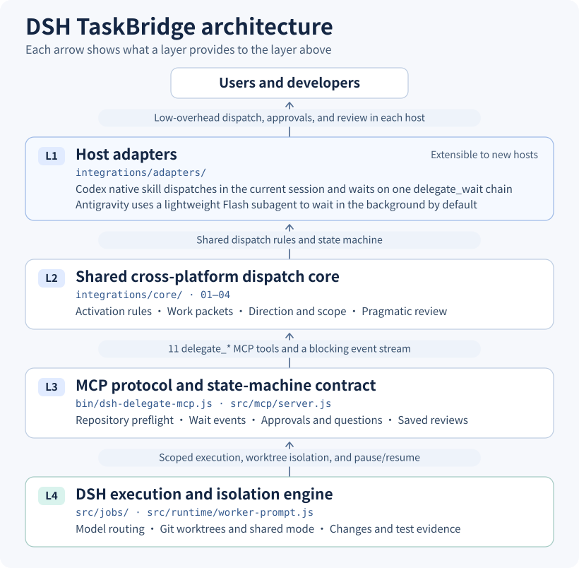

<p align="center">
  
</p>

<h1 align="center">DSH TaskBridge</h1>

<p align="center">
  <strong>Let Codex and Antigravity focus on architecture planning and final review — delegate heavy coding and test loops to <a href="https://github.com/deepseek-ai/deepseek-harness">DeepSeek Harness</a> in isolated Git worktrees.</strong>
</p>

<p align="center">
  
  <a href="README.zh-CN.md"></a>
</p>

<p align="center">
  <a href="https://www.npmjs.com/package/dsh-taskbridge"></a>
  
  = 24" />
  
  <a href="LICENSE"></a>
</p>

<p align="center">
  <a href="#quick-start"><b>Quick Start</b></a> &nbsp;·&nbsp;
  <a href="#how-it-compares"><b>How It Compares</b></a> &nbsp;·&nbsp;
  <a href="#benchmark-results--token-savings"><b>Token Savings</b></a> &nbsp;·&nbsp;
  <a href="#key-capabilities"><b>Key Capabilities</b></a> &nbsp;·&nbsp;
  <a href="#how-it-works"><b>How It Works</b></a> &nbsp;·&nbsp;
  <a href="#faq"><b>FAQ</b></a> &nbsp;·&nbsp;
  <a href="CHANGELOG.md"><b>Changelog</b></a>
</p>

<br />

Stay inside **Codex** or **Antigravity** to inspect repositories, design module contracts, and independently verify deliveries — while offloading verbose implementation and iterative test-fixing loops to **DeepSeek Harness (DSH)** on your machine (Claude Code / Claude Desktop support is planned for `2.0`):

- **Save 40%–52% flagship effective tokens (55%–68% output) with `7/7` full pass:** Across our 7-task paired black-box benchmark suite, multi-file features and refactors cut flagship model token burn dramatically without sacrificing delivery quality (`33.61%` net total-token reduction including cache reads on Antigravity `T1–T5`).
- **True Git `worktree` parallel isolation + one-click safe sync back:** Tasks run in clean isolated Git worktrees by default (with cross-subtask reuse), **never touching your active branch or uncommitted drafts**; accepted diffs sync back to your workspace after zero-destruction conflict prechecks without auto-committing.
- **Silent long waits & per-call fingerprint approvals:** Wait `20–60 minutes` in a single call with zero polling loops; watch live DSH sessions in the sidebar, and approve any out-of-sandbox command one call at a time against its exact argument fingerprint.

> **Current Release `1.9.3`:** Adds zero-destruction post-acceptance worktree-to-source auto-sync (`applyToSource: true` / `sourceSync`), strengthens Codex upfront contract briefs and single-call worker test approval boundaries, and sets new token-saving highs on both hosts; see [1.9.3 Release Notes (ZH)](docs/releases/1.9.3.zh.md) and [1.9.2 Release Notes (ZH)](docs/releases/1.9.2.zh.md).

<p align="center">
  
</p>

---

## Quick Start

### 1. Install in DSH

Open **Plugins → Add plugin** in DSH, enter the package name, and enable it:

```text
dsh-taskbridge
```

> Switch to the official npm registry if a regional mirror lags behind, or install `dsh-taskbridge-1.9.3.tgz` from [GitHub Releases](https://github.com/ranranyya/dsh-taskbridge/releases). Requires Node.js 24+ (automatically resolved from DSH's bundled runtime — never writing the desktop GUI executable `DeepSeek Harness.exe`).

### 2. Pick Your Worker Model

1. Open **Plugins → Installed plugins → dsh-taskbridge → API management** and enable an existing DSH provider.
2. Switch to **Execution settings** and select the provider, worker model, and reasoning effort.
3. Confirm changes show as saved.

### 3. One-Click Host Integration

- **Codex:** Open **Codex integration** and click **Install / update TaskBridge skill** (writes `skills/dsh-taskbridge/SKILL.md`, its rules reference appendix, and the `config.toml` MCP entry while safely retiring untouched legacy `agents/dsh-taskbridge.toml`). Start a new Codex session and dispatch with `$dsh-taskbridge` or an explicit DSH / TaskBridge instruction.
- **Antigravity:** Open **Antigravity integration** and click **Install / update Antigravity plugin** (installed cleanly under `~/.gemini/config/plugins/dsh-taskbridge/` without touching global configs). Dispatch with `@[plugin:dsh-taskbridge]` / `@dsh-taskbridge` or an explicit instruction; select **Always Allow** on the first `delegate_*` prompt so silent waiting runs uninterrupted.

### 4. Flip the Switch & Dispatch

Turn on **Allow local MCP calls to DSH delegation** at the top of the settings page (off by default), then assign a task from your host:

> Use TaskBridge to have DSH implement the tiered overage billing module and export CLI in this repository. Inspect the specs first, define the module contracts and boundaries, dispatch the implementation and unit tests to DSH, and review the delivered diff and test suite before accepting.

Watch the worker live under DSH's `TaskBridge` workspace group, or inspect full progress and review history anytime in **Task history**.

---

## How It Compares

| Dimension | **DSH TaskBridge** | Model-Swap Proxy / Gateway | In-Place Subagent |
| --- | --- | --- | --- |
| **Main chat keeps flagship model** | **Yes (plans specs & reviews diffs only)** | No, replaces the whole session model | Yes |
| **Workspace & branch safety** | **Isolated Git `worktree` per task in parallel** | Edits working directory in place | Usually edits in place or blocks concurrent runs |
| **Post-review workspace sync** | **Conflict-prechecked auto-sync back (never auto-commits)** | No handoff step | Already mutated working tree in place |
| **Live visibility** | **Live DSH sessions grouped under `TaskBridge` + Task board** | Mixed into main chat context | Main chat only sees a text summary |
| **Out-of-sandbox approvals** | **Per-call `allow-once` bound to exact `tool/call` fingerprint** | Follows host global policy | Rarely verifies exact call fingerprints |
| **Multi-stage pipelines** | **`delegate_plan` trees + `reuseWorktreeFromTaskId` chaining** | Manual prompt stitching | Loses isolated intermediate state |

## Why TaskBridge

Frontier reasoning models excel at system design and code review, yet burning their quota on boilerplate implementation and repetitive test debugging gets expensive fast — while manually copying prompts and diffs across windows quickly loses context. TaskBridge connects both sides through a four-layer architecture:

- **L1 Host-native zero-busy-wait adapters:**
  - **Codex (`1.9.0+` Native Skill):** Installs a compact entry `skills/dsh-taskbridge/SKILL.md` plus an on-demand reference appendix so the active Codex session calls `tools.mcp__dsh_delegate__*` directly in Code Mode (avoiding bulk `ALL_TOOLS` dumps) and drives a single `delegate_submit({ autoPreflight: true, wait: true })` + `delegate_wait` chain (`yield_time_ms: 1200000` with `tool_timeout_sec = 3660`), completely eliminating legacy `spawn_agent` + short-timeout `wait_agent` polling loops while safely retiring untouched legacy `.toml` subagents.
  - **Antigravity (Self-contained plugin bundle):** Offloads preflight, silent wait loops, and routine approvals to a lightweight `flash` background subagent so the flagship host model stays asleep until a compact structured delivery receipt is ready for review.
- **L2 Shared architect-style dispatch core:** Unified single-source rules across hosts — **decompose large multi-subsystem goals (`delegate_plan`) + steer architecture, exported contracts, and scope redlines (never dictating line-by-line code or pseudocode in prompts) + enforce pragmatic review (consolidate real spec/bug/test defects into one rework round; never invent out-of-spec fuzz probes)**.
- **L3 Bounded compact MCP protocol:** Single-line JSON payloads, one-call `autoPreflight` + `wait` submission, and diff-free local review receipts (`includeDiff: false` / `receiptOnly: true`).
- **L4 Isolated Git worktrees, zero-destruction sync & seamless continuations:** Runs in isolated Git worktrees by default; downstream multi-stage subtasks can reuse an accepted isolated worktree with a fresh DSH Session via `reuseWorktreeFromTaskId` without touching the user's source checkout; follow-up fixes resume the exact session via `continueFromTaskId`; passing `applyToSource: true` on the final `accepted` review automatically syncs verified changes back to `sourcePath` after conflict prechecks without auto-committing; linked cleanup removes histories, archived sessions, and temporary worktrees in one click.

---

## Benchmark Results & Token Savings

We evaluated **Antigravity (`1.9.1` → `1.9.3`)** and **Codex (`1.9.0` → `1.9.3`)** across a 7-task deterministic black-box benchmark suite (`T0A` non-dispatch chat boundary, `T0B` 3 invalid/uncommitted Git directory blocks, `T1` core quota-ledger implementation, `T2` tiered overage billing & audit report, `T3` discount engine & export CLI, `T4` dirty-checkout uncommitted draft preservation, and `T5` an enterprise 3-domain billing platform refactor with **235+ unit tests + 6 read-only SHA-256 fixture checks**), pairing each host against its own no-plugin strong-model baseline under identical fixtures and grading scripts. DSH ran `deepseek-v4.1-flash` as the worker.

### 1. Cross-Host Summary

| Host & Commander | Mode | Full Suite Passed | `T1–T5` Paired Passed | `T1–T5` Avg. Commander Turns | `T1–T5` Strong-Model Effective Tokens (Uncached In + Out) | Quota & Token Reduction | `T1–T5` Strong-Model Total Tokens (incl. Cache) | Auxiliary / DSH Worker Tokens |
| --- | --- | :---: | :---: | ---: | ---: | ---: | ---: | ---: |
| **Antigravity**<br>`gemini-4-neon-high` | No-plugin baseline | — | 5/5 (Avg. 100) | 11.00 | 618,861<br>*(Out: 191,677)* | Baseline | 3,276,639 | 0 |
| **Antigravity**<br>`gemini-4-neon-high` | **`1.9.3-test1`**<br>(`flash` subagent + auto-sync) | **7/7 (Avg. 100)**<br>*0 reworks* | **5/5 (Avg. 100)** | **10.00**<br>*(Below baseline; 7-task: 8.29)* | **374,844**<br>*(7-task: 436,350; Out: 67,985)* | **Saved 39.43%**<br>*(Output **-64.53%**; Total **-33.61%**)* | **2,175,330**<br>*(7-task: 2.35M, **-33.5%** vs 1.9.1)* | Flash aux: 1,725,982<br>+ DSH worker |
| **Codex CLI**<br>`gpt-6.2-sol (xhigh)` | No-plugin baseline | — | 4/5 (Avg. 96) | 11.20 | 608,065<br>*(Out: 66,816)* | Baseline | 1,966,145 | 0 |
| **Codex CLI**<br>`gpt-6.2-sol (xhigh)` | **`1.9.2` Code Mode Slimmed**<br>(`test3` isolated / `test4` manual sync) | **4× consecutive 7/7 (100)** | **5/5 (Avg. 100)**<br>*Exceeds 4/5 baseline* | 21.60–24.00<br>*(7-task: 113–126 turns)* | Out: 47,085–59,683<br>*(`custom` proxy eff: 1.20M–1.48M\*)* | Output -10.7% to -29.5%<br>*(Total tokens -34% to -44% vs 1.9.1)* | 6,274,024–7,350,171<br>*(7-task: 6.41M–7.51M)* | DSH worker |
| **Codex CLI**<br>`gpt-6.2-sol (xhigh)` | **`1.9.3-test1` / `test2`**<br>(source-graded after auto-sync) | **2× consecutive 7/7 (100)** | **5/5 (Avg. 100)**<br>*Exceeds 4/5 baseline* | **22.60–23.20**<br>*(7-task: **119–122 turns**; **0** manual sync cmds)* | **437,191–447,111**<br>*(7-task: 465k–467k; Out: **41,825–47,553**)* | **Saved 26.47%–28.10%**<br>*(Output **-28.83% to -37.40%**)* | **5,874,887–6,335,111**<br>*(7-task: **6.01M–6.46M**, all-time low)* | DSH worker |

> **Verification & channel notes:**
> 1. **Zero false dispatch, zero truncation & zero manual sync:** Both hosts answered `T0A` directly with zero dispatch calls and blocked all three invalid repository layouts on `T0B`. In `1.9.3`, every `worktree` task (`T1`, `T2`, `T3`, `T5`) synced back cleanly via `delegate_review(..., applyToSource: true)` and passed black-box grading directly against `sourcePath`, driving post-acceptance manual copy/re-test commands down to **`0`**.
> 2. **New cross-release highs on both hosts:** On Antigravity, `1.9.3` cut 7-task flagship total tokens by **33.5%** (`3.54M → 2.35M`) and effective tokens by another **12.6%** vs. `1.9.1`, achieving **+33.61% net total-token savings** (including cache reads) and fewer commander turns (`10.00` vs. `11.00`) than the no-plugin baseline. On Codex, `1.9.3` cut 7-task total tokens by **43.3%–47.3%** vs. the `1.9.1` full-pass run (`11.39M`) and **13.9%–20.0%** vs. the `1.9.2` manual-sync run (`7.51M`), while delivering **26.47%–28.10%** net effective-token savings on `T1–T5`.
> 3. **\*Transport cache-rate note:** The `1.9.2` runs used a WebSocket proxy channel (`79.6%–83.7%` cache hit rate), whereas the two `1.9.3` runs operated over HTTPS with normal `92.8%–93.5%` prompt-cache hit rates (matching `1.9.0` / `1.9.1`), setting new full-pass bests across both effective and total token metrics.

### 2. Per-Task Strong-Model Savings Breakdown (`1.9.3` vs. Same-Host Baseline, `T1–T5`)

| Task & Scope | Antigravity Baseline → `1.9.3` Effective | Antigravity `1.9.3` Savings | Codex Baseline → `1.9.3` Effective | Codex `1.9.3` Savings & Total Volume |
| --- | ---: | --- | ---: | --- |
| **`T4`** · Small dirty-repo fix preserving uncommitted drafts (7 tests) | 44,731 → 53,771 | -20.21% *(fixed overhead; output **-39.9%**)* | 81,590 → **54,843–69,548** | **+14.76%–32.78%**; total `0.62M–0.69M` *(**-32% to -39%** vs 1.9.2 synced)* |
| **`T1`** · Core quota-ledger implementation (20 tests) | 73,559 → **49,656** | **+32.50%** *(total **-10.7%**, output **-64.2%**)* | 52,768 → 74,412–88,534 | -41.02% to -67.78%; `test2` down to **`13` turns / `0.44M` total** *(**-38.4%** vs 1.9.2)* |
| **`T2`** · Tiered overage billing & audit report (39 tests) | 92,737 → **59,526** | **+35.81%** *(total **-27.1%**, output **-62.2%**)* | 100,570 → **53,646–57,122** | **+43.20%–46.66%**; full `100/100` (vs `80` baseline); total **`0.49M–0.55M`** |
| **`T3`** · Discount engine, ledger integration & CLI (51 tests) | 85,481 → **57,477** | **+32.76%** *(total **-32.4%**, output **-68.7%**)* | 82,885 → **79,831**–113,284 | `test2` **+3.68%** net savings; `test1` total `0.82M` (`20` turns) |
| **`T5`** · Enterprise 3-domain billing platform (235+ tests + 6 SHA-256 contracts) | 322,353 → **154,414** | **+52.10%** *(total **-44.6%**, output **-67.9%**, `15` turns)* | 290,252 → **141,006–152,076** | **+47.61%–51.42%** *(output **-55.3% to -60.3%**; total `3.23M–3.56M`)* |

### 3. Key Benchmark Conclusions

1. **Lightweight worker + strong host review achieves `7/7` (700/700) full pass on both hosts:** Even with a lightweight `deepseek-v4.1-flash` worker, clear upfront contract briefs combined with independent host verification delivered **7/7 (700/700)** across Antigravity (`1.9.3`, zero reworks) and six consecutive Codex `1.9.2`–`1.9.3` runs — consistently surpassing the `4/5` no-plugin Codex baseline on `T2`.
2. **Savings scale with task complexity (`47.6%–52.1%` effective savings and `55%–68%` output reduction on `T5`):** Multi-file features and cross-module refactors (`T1`, `T2`, `T3`, `T5`) offload heavy code output and test loops to DSH, cutting Antigravity `T1–T5` flagship output by **64.5%** and Codex `T1–T5` output by **28.8%–37.4%** (`T5` output **-55.3% to -60.3%**). Tiny single-point edits (`T1`/`T4` scale) carry fixed preflight/review overhead and can be edited directly in the host.
3. **Zero-destruction auto-sync closes the last mile and lowers total token volume on both hosts:** `applyToSource: true` eliminates manual post-review copy scripts and duplicate test runs in `sourcePath` — Antigravity cuts `T1–T5` flagship total tokens (including cache) **33.61% below** the no-plugin baseline (`2.18M` vs. `3.28M`), while Codex compresses 7-task total tokens down to **`6.01M–6.46M`** with **`26.5%–28.1%`** net effective savings.
4. **Trades background wall-clock time for flagship quota:** Under concurrency, `1.9.3` finishes the full 7-task suite (including `T5` and safe source write-back) in ~**27–46 minutes**, making it ideal for background or parallel worktree delegation.

---

## Key Capabilities

| Capability | What You Get |
| --- | --- |
| **One-click host integration** | Dedicated settings tabs for Codex and Antigravity to install, update, repair MCP only, or cleanly remove managed integrations (including automatic retirement of untouched legacy Codex `.toml` subagents) while preserving any user edits via SHA-256 content digests. |
| **Reuse DSH APIs, models & effort** | Select providers, worker models, and reasoning effort already configured in DSH; API keys never leave DSH. |
| **Plan trees, worktree reuse & linked cleanup** | Decompose multi-stage goals with `delegate_plan`; pass `reuseWorktreeFromTaskId` so dependent subtasks start a fresh DSH Session on an accepted isolated worktree; filter **Task history** by date, jump to native sessions, and clean task chains, archived sessions, and isolated worktrees in one click. |
| **Parallel worktree isolation & workspace tree** | Run isolated parallel Git worktrees (nested under DSH's `TaskBridge` sidebar root and titled per task) or explicit shared checkouts (preserving the project's native workspace name). |
| **Tiered silent monitoring** | No default total execution cap; runs one local read-only self-check 10 minutes after start, checks in with the host after 40 minutes without a new delivery, and deduplicates repeated tool-failure reminders (all configurable). |
| **Single-call approvals & native questions** | The host approves each out-of-sandbox call using its exact argument fingerprint. Native DSH questions forward and resume waiting in one call. |
| **Optional Agent Teams & project overrides** | `agentTeams` is off by default and configurable globally or per dispatch; settings auto-save with reusable presets and per-project path overrides. |

---

## How It Works

### Independent Worktree vs. Shared Workspace

| Mode | Where Edits Land & Sidebar Placement | Best For |
| --- | --- | --- |
| **Independent worktree (`worktree`, default)** | Branches an isolated Git worktree from committed `HEAD`; grouped under DSH's `TaskBridge` sidebar node and named after the task title; downstream subtasks can chain onto the same isolated tree via `reuseWorktreeFromTaskId`. | Keeping experimental or parallel tasks isolated from your main checkout until review; linked cleanup can remove temporary worktrees in one click. |
| **Shared workspace (`shared`)** | Edits the authorized project directory in place; reuses the project's native DSH workspace and preserves its original workspace title. | Continuing directly on uncommitted local changes after explicit preflight confirmation; strictly protected from linked cleanup deletion. |

> **Git repository requirement:** Both modes require an initialized Git repository root with at least one commit. Recording `accepted` via `delegate_review` never auto-commits or pushes; in `worktree` mode, passing `applyToSource: true` on the final `accepted` review automatically syncs verified changes back to your source checkout after zero-destruction conflict prechecks (reporting any conflicting paths with zero bytes modified).

### Quiet Waiting & Tiered Monitoring

- **10 minutes after start (default, configurable):** Runs one local read-only self-check with zero LLM cost across the entire run.
- **40 minutes with no new delivery (default, configurable):** Returns a compact progress check-in to `delegate_wait` without cancelling the run.
- **Repeated identical tool failures (default: 3):** Surfaces a deduplicated `eventId` reminder to prevent runaway retry loops. See [Silent waiting](docs/silent-wait.md).

---

## FAQ

**Does installing TaskBridge send ordinary chat or code questions to DSH?**
No. Both the local delegation switch AND an explicit assignment of a Git-repository implementation or verification task are required. General Q&A stays directly in your host with zero tool calls.

**Will updates overwrite my edits to `SKILL.md` or legacy `dsh-taskbridge.toml`?**
No. Ownership is proved by SHA-256 content digests; customized files are preserved verbatim. Use **Repair MCP only** to refresh just the MCP entry.

**Does Antigravity integration touch my global `mcp_config.json`?**
No. Everything is self-contained inside `~/.gemini/config/plugins/dsh-taskbridge/`, and removing the integration cleans only managed plugin files.

**When should I delegate vs. edit directly in the host?**
Edit tiny single-file tweaks directly in the host. Delegate multi-file features, complex business rules, test suites, and cross-module refactors to TaskBridge to save **26%–52%** of flagship effective tokens (up to **68%** output reduction on heavy refactors) while maintaining full architectural review control.

## Host Support & Roadmap

| Host | Status | Integration |
| --- | --- | --- |
| **Codex** | Supported (`1.9.0+` Native Skill) | One-click `skills/dsh-taskbridge/SKILL.md` + reference appendix + MCP (auto-retires untouched legacy subagents) |
| **Antigravity** | Supported | One-click self-contained plugin (`plugins/dsh-taskbridge/`: Skill + `flash` Subagent + MCP) |
| **Claude Code / Claude Desktop** | Planned (`2.0`) | Shares the same layered dispatch core and bounded MCP surface; see [Claude roadmap](docs/claude-code.md) |

## Documentation & Feedback

- [简体中文完整文档](README.zh-CN.md) · [1.9.3 Release Notes (ZH)](docs/releases/1.9.3.zh.md) · [1.9.2 Release Notes (ZH)](docs/releases/1.9.2.zh.md) · [1.9.1 Release Notes (ZH)](docs/releases/1.9.1.zh.md) · [1.9.0 Release Notes (ZH)](docs/releases/1.9.0.zh.md)
- [Codex integration](docs/codex-integration.md) · [Antigravity integration](docs/antigravity-integration.md) · [Claude roadmap](docs/claude-code.md) · [Silent waiting](docs/silent-wait.md)
- [Workspace isolation](docs/workspace-contract.md) · [Conversation placement](docs/conversation-placement.md) · [Runtime compatibility](docs/runtime-compatibility.md) · [Plugin market](docs/plugin-market.md) · [Legacy migration](docs/taskbridge-upgrade.md)

Report issues or suggestions on [GitHub Issues](https://github.com/ranranyya/dsh-taskbridge/issues) with your plugin version, reproduction steps, and redacted diagnostics (never include API keys).

## License

[MIT](LICENSE)

---

<details>
<summary>Advanced Installation, Configuration & Protocol Reference</summary>

### 1. Environment Requirements

| Item | Requirement | Notes |
| --- | --- | --- |
| DSH | Capability-checked, no version whitelist | Does not declare `engines.dsh`; host-provided `@deepseek-ai/dsh-*` peers use `*`. Required model-routing and approval APIs are verified by runtime capability checks; see [`docs/runtime-compatibility.md`](./docs/runtime-compatibility.md). |
| Node.js | `>= 24` | Matches DSH `0.2.0-rc.2` / `0.2.1-rc.2` runtime (native ESM, `AbortSignal.timeout`, `node --test`). |
| OS | Windows / Linux / macOS | Automated suite runs on Windows + Node 24; Git worktree isolation fails closed with a clear refusal if `git` is unavailable. |

### 2. Installation Paths (Desktop vs. CLI Web Profile)

DSH installs plugins as profile bundles (`$DSH_HOME/profiles/<name>`). Do not mix Desktop and CLI profile management:

1. **DSH Desktop (Recommended):** Manage installation, updates, and removal exclusively inside **Plugins manager → Add plugin** (`dsh-taskbridge`, or select a local tarball built via `npm pack` → `dsh-taskbridge-1.9.3.tgz`). Never run `dsh plugin` or `npm`/`pnpm` directly against Desktop's reserved profile.
2. **CLI Web Profile (Non-Desktop only):**

```bash
# Install into a CLI profile (e.g., web)
dsh plugin --profile web add ./dsh-taskbridge-1.9.3.tgz && dsh plugin --profile web why dsh-taskbridge

# Launch DSH
dsh --profile web
```

> For isolated testing on CLI profiles, use a disposable profile (`dsh plugin --profile dsh-delegate-try add ./dsh-taskbridge-1.9.3.tgz`) with a temporary `DSH_HOME`.

### 3. Settings & Local Switch

The configuration UI mounts at `plugins.bundle.config` under **Plugins → Installed plugins → dsh-taskbridge**:
- **Local MCP delegation switch:** Off by default; never auto-enabled by installation or prompts. Closing the switch immediately blocks new submissions and requests cancellation of running tasks while keeping read-only status/result queries available.
- **5 tabs:** API Management, Execution Settings, Task History, Codex Integration, and Antigravity Integration.

### 4. MCP (`stdio`) Surface & Continuation Rules

`bin/dsh-delegate-mcp.js` (`dsh-delegate-mcp` / `dsh-taskbridge-mcp`) exposes 11 bounded tools: `delegate_status`, `delegate_preflight`, `delegate_submit`, `delegate_wait`, `delegate_result`, `delegate_cancel`, `delegate_permission_decide`, `delegate_question_answer`, `delegate_review`, `delegate_plan`, and `delegate_metrics`.

- **Loopback discovery:** Connects to DSH over loopback via `$DSH_HOME/data/dsh-delegate/runtime-endpoint.json` (re-read before every tool call, surviving DSH port changes across restarts without editing host configs).
- **Session continuation (`continueFromTaskId`):** Omitting `continueFromTaskId` always opens a fresh DSH Session. Supplying it resumes the exact prior Session and workspace only when proven to belong to the same authenticated `connectionId` (`local-mcp` for local stdio) and a continuable terminal record.
- **Cross-subtask worktree reuse (`reuseWorktreeFromTaskId`):** Mutually exclusive with `continueFromTaskId`; opens a fresh DSH Session on top of an upstream task's accepted isolated worktree without mutating `sourcePath`.
- **Preflight (`delegate_preflight`):** Read-only repository check returning `worktree` (clean repo), `block` with `PREFLIGHT_DIRTY_NEEDS_DECISION` (dirty repo without explicit confirmation), `shared` (when `allowShared: true` is passed), or `block` for non-Git/invalid paths.

### 5. Codex Runtime Resolution & Ownership Safety

- **Node.js runtime resolution:** When running inside **DSH Desktop (Electron)**, `process.execPath` is `DeepSeek Harness.exe` and is **never** written into Codex `config.toml` as the MCP `command`. Instead, the installer resolves DSH's bundled Node runtime (`<resources>/runtime/primary-runtime/dependencies/node/bin/node.exe` on Windows, or `node` on POSIX), falling back to explicit absolute-file overrides `DSH_NODE_PATH` → `DSH_NODE_EXECUTABLE` → `CODEX_MCP_NODE_PATH`, or failing closed with `MCP_EXECUTABLE_UNRESOLVED`.
- **Digest-verified non-destructive updates:** Managed `skills/dsh-taskbridge/SKILL.md`, retired legacy `agents/dsh-taskbridge.toml`, and `config.toml` `[mcp_servers.dsh-delegate]` entries are only updated or removed when their bytes match known published templates or local ownership records; user-modified files are never overwritten.
- **CLI entry (`dsh-delegate-codex-agent`):**

```bash
node bin/dsh-delegate-codex-agent.js install   # Install/update native skill + MCP entry
node bin/dsh-delegate-codex-agent.js status    # Read-only diagnostics
node bin/dsh-delegate-codex-agent.js repair    # Repair MCP entry only
node bin/dsh-delegate-codex-agent.js remove    # Remove plugin-managed entries only
```

### 6. Out-of-Band Control CLI (`dsh-delegate-control`)

For serial MCP hosts whose connection is occupied by a long `delegate_wait` call, `dsh-delegate-control status <taskId>` and `dsh-delegate-control cancel <taskId>` provide bounded (≤ 10s) out-of-band status inspection and explicit cancellation over the same loopback endpoint.

## 7.1 Worker Session Permissions (0.1.12+ for DSH 0.2.2)

Before delivering a prompt, TaskBridge applies native DSH session permissions and verifies read-back through DSH's own services:

- Sandbox mode is pinned to `workspace-write`. Approval policy is set to `ask` **only** when a per-call permission bridge is armed and bound to that exact worker Agent; otherwise it stays `never` (deterministic refusal, never auto-approval).
- Both `sandbox/mode` and `approval/policy` events are read back via `ctx.sandboxPolicy.resolve({ session })` and `ctx.approval.effectivePolicy(session)` before prompt delivery, failing closed with `RUN_SANDBOX_POLICY_UNAVAILABLE` or `RUN_PERMISSION_BRIDGE_UNAVAILABLE` on any mismatch.
- `allow-once` via `delegate_permission_decide` requires an exact match against the complete, untruncated `tool/call` argument fingerprint in the Session log and applies strictly to that single invocation. See [`docs/worker-permissions.md`](./docs/worker-permissions.md).

### 8. Upgrade, Rollback & Development

```bash
# Upgrade or roll back on a CLI web profile
dsh plugin --profile web add ./dsh-taskbridge-1.9.3.tgz
dsh plugin --profile web remove dsh-taskbridge

# Repository development & verification
npm install
npm test
npm run check:integrations
npm run check:client
npm run pack:dry
```

Full Chinese protocol and historical notes are available in [README.zh-CN.md](README.zh-CN.md).

</details>
