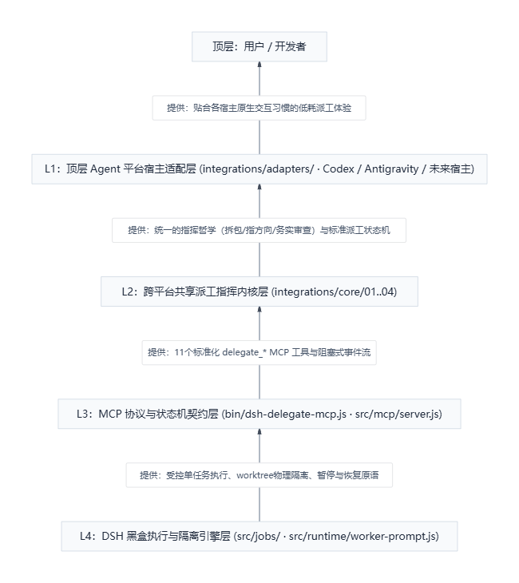

<p align="center">
  
</p>

<h1 align="center">DSH TaskBridge</h1>

<p align="center">
  <strong>让 Codex 与 Antigravity 专注架构规划与验收把关，把重度写代码和跑测试交给 <a href="https://github.com/deepseek-ai/deepseek-harness">DeepSeek Harness</a> 在独立 Git worktree 中并行干活。</strong>
</p>

<p align="center">
  <a href="README.md"></a>
  
</p>

<p align="center">
  <a href="https://www.npmjs.com/package/dsh-taskbridge"></a>
  
  = 24" />
  
  <a href="LICENSE"></a>
</p>

<p align="center">
  <a href="#快速上手"><b>快速上手</b></a> &nbsp;·&nbsp;
  <a href="#和其他方案的区别"><b>方案对比</b></a> &nbsp;·&nbsp;
  <a href="#双端基准测试与省流实测"><b>省流实测</b></a> &nbsp;·&nbsp;
  <a href="#核心能力"><b>核心能力</b></a> &nbsp;·&nbsp;
  <a href="#设置与机制"><b>设置与机制</b></a> &nbsp;·&nbsp;
  <a href="#常见问题"><b>常见问题</b></a> &nbsp;·&nbsp;
  <a href="CHANGELOG.md"><b>更新日志</b></a>
</p>

<br />

在 **Codex** 或 **Antigravity** 中正常阅读仓库、设计接口契约并做最终审查，把耗费大量代码输出与反复跑单测排错的工程任务交给本机 **DeepSeek Harness（DSH）** 执行（Claude Code / Claude Desktop 计划于 `2.0` 上线）：

- **实测省下大半主力配额，且 `7/7` 全满分不降质**：7 题双端黑盒基准实测中，中大型与重型重构任务让旗舰模型**有效 Token 净省 40%–52%、代码输出直降 55%–68%**（Antigravity 全套 `T1–T5` 含缓存总流量净省 **33.61%**）。
- **独立 Git `worktree` 真并行隔离 + 验收后一键零破坏写回**：默认在干净隔离工作树中并行开发（支持跨子包接力复用），**绝不污染当前分支或未提交草稿**；终局验收通过后自动完成冲突预检并安全写回主工作区（绝不自动 `git commit`）。
- **静默长等免轮询 + 敏感操作逐次指纹审批**：单次调用最长静默等待 20–60 分钟、零轮询空转；DSH 原生界面全程实时可见，超出工作区写边界的命令按真实参数指纹逐次交由宿主审批。

> **当前正式版 `1.9.3`**：新增 `worktree` 终局验收后零破坏冲突预检与安全自动写回（`applyToSource: true` / `sourceSync`），强化 Codex 首轮契约指引与单次测试审批边界；详见 [1.9.3 更新说明](docs/releases/1.9.3.zh.md) 与 [1.9.2 更新说明](docs/releases/1.9.2.zh.md)。

<p align="center">
  
</p>

---

## 快速上手

### 1. 在 DSH 中安装插件

在 DSH 中打开 **插件 → 添加插件**，输入包名安装并启用：

```text
dsh-taskbridge
```

> 若区域镜像尚未同步最新版，可切换 npm 官方源，或从 [GitHub Releases](https://github.com/ranranyya/dsh-taskbridge/releases) 下载 `.tgz` 本地安装。本机 MCP 连接需要 Node.js 24+，插件集成安装器会自动检测可用运行时（绝不会误写桌面端可执行文件）。

### 2. 配好执行模型

1. 打开 **DSH TaskBridge 设置 → 接口管理**，从“DSH 已启用的接口”中勾选要复用的提供方。
2. 切到 **执行设置**，选定执行提供方、执行模型与支持的思考强度。
3. 确认页面底部提示“已保存”或“所有修改已保存”。

### 3. 一键接入宿主端

- **接入 Codex**：切到 **Codex 集成**，点击 **安装 / 更新 TaskBridge 技能**（写入原生技能 `skills/dsh-taskbridge/SKILL.md`、同目录规则附页与 `config.toml` MCP 条目，并自动清理未修改的旧 `agents/dsh-taskbridge.toml`），完成后重启或新开 Codex 会话，即可通过 `$dsh-taskbridge` 或明确说明“交给 DSH / TaskBridge”由当前会话直接单链派工与静默长等。
- **接入 Antigravity**：切到 **Antigravity 集成**，点击 **安装 / 更新 Antigravity 插件**。插件会写入独立的 `~/.gemini/config/plugins/dsh-taskbridge/`（内含 `SKILL.md`、轻量后台子智能体和插件内 `mcp_config.json`，不碰全局配置），Antigravity 加载后即可通过 `@[plugin:dsh-taskbridge]` / `@dsh-taskbridge` 或明确指令派工。首次调用 `delegate_*` MCP 工具时若弹出外部工具确认框，建议勾选 **Always Allow**，避免打断静默等待与审批续等。

### 4. 打开总开关，派发第一个任务

打开设置页顶部的 **允许本机 MCP 调用 DSH 委派**（新安装默认关闭，关闭即拒收新任务并中止运行中任务）。接着在你的宿主端中给出需求，例如：

> 用 TaskBridge 把当前仓库的分层超额计费模块和导出 CLI 交给 DSH 实现。你先核对现有目录与规范定好接口契约和边界，拆包或单包派给 DSH 完成编码与单测；交付后独立核验 diff 与测试结果并记录验收结论，若有缺陷就续接原任务修完。

你可以在 DSH 左侧原生工作区实时围观执行过程，也可以在插件设置页 **任务记录** 中随时查看进展与完整验收记录。

---

## 和其他方案的区别

| 维度 | **DSH TaskBridge** | 模型中转 / 替换网关 | 同目录直改子代理 |
| --- | --- | --- | --- |
| **主对话保留原旗舰模型** | **是（只负责架构拆解与最终验收）** | 否，整场对话被降级替换 | 是 |
| **代码改动与主分支隔离** | **默认独立 Git `worktree` 并行，互不踩踏** | 无隔离，直接改当前目录 | 多在同一目录直接改或串行阻塞 |
| **验收后同步回原工作区** | **冲突预检后一键零破坏自动写回（不自动 commit）** | 无交接步骤 | 已经在原目录改完，难以回退 |
| **执行过程可见性** | **DSH 侧栏 `TaskBridge` 节点下实时可见 + 任务看板** | 混在主对话流中消耗上下文 | 主对话仅看到文字总结 |
| **越权命令控制** | **按真实 `tool/call` 参数指纹逐次审批（`allow-once`）** | 跟随宿主全局放行策略 | 通常无独立参数指纹复核 |
| **多阶段长链路开发** | **支持 `delegate_plan` 任务树 + 跨子包复用同一隔离树** | 手工拼接上下文 | 容易丢失前序工作树状态 |

## 为什么选择 TaskBridge

当你信任高阶旗舰模型（如 GPT / Gemini 高推理档位）的架构设计与代码审查能力，但不想让它在样板代码编写和反复跑单测排错上快速消耗宝贵配额，同时又厌倦了在多个窗口间手工粘贴提示词与 diff 时，TaskBridge 通过四层架构直接打通协同闭环：

- **L1 宿主因地制宜，零空转等待**：
  - **Codex 端（`1.9.0+` 原生技能）**：安装紧凑入口 `skills/dsh-taskbridge/SKILL.md` 与按需读取附页，在 Code Mode 下直接调用 `tools.mcp__dsh_delegate__*`（免整组打印 `ALL_TOOLS` 防输出截断）并驱动 `delegate_submit({ autoPreflight: true, wait: true })` + 单链 `delegate_wait`（全链路 `yield_time_ms: 1200000` 配合 `tool_timeout_sec = 3660` 静默长等），彻底根除旧版 `spawn_agent` + 短超时 `wait_agent` 的高频轮询空转，并自动安全退役未修改的旧 `.toml` 子智能体。
  - **Antigravity 端（自包含插件包）**：默认将预检、等待循环与常规权限审批卸载给轻量 `flash` 后台子智能体托管，主旗舰模型零唤醒挂起，仅在交付后接收精简结构化证据完成最终审查。
- **L2 架构师式派工，杜绝代写与洁癖返工**：双端共享单一真源派工内核——**大任务拆小包（`delegate_plan`）+ 指明架构骨架、接口契约与范围红线（严禁宿主端在提示词中代写逐行实现代码或伪代码）+ 务实独立审查（仅对违背规范、真 Bug、测试失败或越界残留合并一轮打回，拒绝超纲假设空耗）**。
- **L3 紧凑有界 MCP 协议**：支持预检、提交与首段等待合并为一次调用。单行 JSON 载荷支持在本地审查时省略补丁正文或只返回回执（`includeDiff: false` / `receiptOnly: true`）。
- **L4 Git 工作树并行隔离、零破坏自动写回与无缝续接**：默认从干净基线拉出独立 `worktree` 并行执行；多阶段下游子包可通过 `reuseWorktreeFromTaskId` 在同一隔离工作树上开启全新干净 DSH 会话（全程不污染主仓库）；同一任务返工通过 `continueFromTaskId` 原会话续接；终局 `accepted` 传入 `applyToSource: true` 即可通过冲突预检后自动写回原工作区（绝不自动 `git commit`），完成后支持按任务链一键联动清理。

---

## 双端基准测试与省流实测

我们使用覆盖 7 类真实工程场景的跨宿主黑盒基准套件（`T0A` 非指派静默边界、`T0B` 三类非法/未提交 Git 目录只读拦截、`T1` 配额账本核心实现、`T2` 超额计费与审计报告、`T3` 折扣集成与导出 CLI、`T4` 脏工作区未提交草稿完整性保护、`T5` 含 **235+ 项单测 + 6 份只读契约 SHA-256 校验**的企业级三域计费平台重构），在相同初始靶场与统一独立黑盒阅卷脚本下，对 **Antigravity（`1.9.1` → `1.9.3`）** 与 **Codex（`1.9.0` → `1.9.3` 演进实测）** 进行了同宿主无插件直做基线对照。插件组 DSH 执行后端统一采用轻量模型 `deepseek-v4.1-flash`。

### 1. 双端综合实测总览

| 宿主端与主控配置 | 运行模式 | 全集通过（得分） | `T1–T5` 同题通过 | `T1–T5` 主控均步 | `T1–T5` 强模型有效 Token（非缓存输入 + 输出） | 强模型省流与减负成效 | `T1–T5` 强模型含缓存总 Token | 辅助 / DSH 执行端 Token |
| --- | --- | :---: | :---: | ---: | ---: | ---: | ---: | ---: |
| **Antigravity**<br>`gemini-4-neon-high` | 无插件直做基线 | — | 5/5（均分 100） | 11.00 | 618,861<br>*(输出 191,677)* | 基线 | 3,276,639 | 0 |
| **Antigravity**<br>`gemini-4-neon-high` | **`1.9.3-test1`**<br>（`flash` 子智能体 + 自动写回） | **7/7（均分 100）**<br>*全程 0 返工* | **5/5（均分 100）** | **10.00**<br>*(低于基线；7 题 8.29)* | **374,844**<br>*(7 题 436,350；输出 67,985)* | **有效净省 39.43%**<br>*(强模型输出省 **64.53%**；含缓存总流量省 **33.61%**)* | **2,175,330**<br>*(7 题 235.4 万，较 1.9.1 降 **33.5%**)* | Flash 辅助 1,725,982<br>+ DSH 后端执行 |
| **Codex CLI**<br>`gpt-6.2-sol (xhigh)` | 无插件直做基线 | — | 4/5（均分 96） | 11.20 | 608,065<br>*(输出 66,816)* | 基线 | 1,966,145 | 0 |
| **Codex CLI**<br>`gpt-6.2-sol (xhigh)` | **`1.9.2` Code Mode 减负版**<br>（`test3` 隔离 / `test4` 手工写回） | **连续 4 轮 7/7（均分 100）** | **5/5（均分 100）**<br>*超越基线 4/5* | 21.60–24.00<br>*(7 题 113–126 步)* | 输出 47,085–59,683<br>*(转发通道有效 1.20M–1.48M\*)* | 主控输出省 10.7%–29.5%<br>*(较 1.9.1 满分场总 Token 降 34%–44%)* | 6,274,024–7,350,171<br>*(7 题 641 万–751 万)* | DSH 后端执行 |
| **Codex CLI**<br>`gpt-6.2-sol (xhigh)` | **`1.9.3-test1` / `test2`**<br>（自动写回后在源目录验收） | **连续 2 轮 7/7（均分 100）** | **5/5（均分 100）**<br>*超越基线 4/5* | **22.60–23.20**<br>*(7 题 **119–122 步**，验收后手写脚本 **0**)* | **437,191–447,111**<br>*(7 题 46.5 万–46.7 万；输出 **41,825–47,553**)* | **有效净省 26.47%–28.10%**<br>*(主控输出省 **28.83%–37.40%**)* | **5,874,887–6,335,111**<br>*(7 题 **600.6 万–646.3 万**，历史最低)* | DSH 后端执行 |

> **核验与演进口径说明**：
> 1. **零误触发、零截断与零手写同步**：`T0A` 普通非代码问答双端均零派工直接作答，`T0B` 三类不合规仓库均被只读预检精准拦截；`1.9.3` 在全部 `worktree` 题目（`T1`、`T2`、`T3`、`T5`）均由 `delegate_review(..., applyToSource: true)` 一次性零冲突同步回原工作区并通过源仓库直接阅卷，验收后手写拷贝脚本与重跑测试回合全部清零为 **`0`**。
> 2. **双端跨代再创新高**：Antigravity 端相比 `1.9.1`（7 题总 Token `353.9 万`、有效 `49.9 万`），`1.9.3` 将强模型含缓存总 Token 压降 **33.5%**（`235.4 万`）、有效 Token 再降 **12.6%**，首次在 `T1–T5` 上实现**含缓存总流量较无插件基线净省 `33.61%`**（主控均步 `10.00` 比无插件基线 `11.00` 更少）；Codex 端相比 `1.9.1` 首个 `7/7` 满分场（`179` 步 / `1,139.2 万` 总 Token）将含缓存总 Token 压降 **43.3%–47.3%**，相比 `1.9.2` 含手工写回场（`751.1 万`）再降 **13.9%–20.0%**，同时实现 `T1–T5` 强模型有效 Token **净省 `26.47%–28.10%`**。
> 3. **\*传输通道缓存率说明**：`1.9.2` 四轮运行于 WebSocket 自定义转发通道（缓存命中率 `79.6%–83.7%`），而 `1.9.3` 两轮通过 HTTPS 通道获得 `92.8%–93.5%` 正常缓存命中率（与 `1.9.0` / `1.9.1` 同级），使主控有效省流率与含缓存总流量双双创下 Codex 满分场最优纪录。

### 2. `T1–T5` 分题强模型省流明细（`1.9.3` vs 同宿主无插件基线）

| 题目与工程特征 | Antigravity 基线 → `1.9.3` 有效 Token | Antigravity `1.9.3` 省流成效 | Codex 基线 → `1.9.3` 有效 Token | Codex `1.9.3` 省流与总量表现 |
| --- | ---: | --- | ---: | --- |
| **`T4`** · 脏仓库小型增量修复（保留未提交草稿） | 44,731 → 53,771 | -20.21% *(小任务固定预检开销，输出仍省 **39.9%**)* | 81,590 → **54,843–69,548** | **+14.76%–32.78%**；总 Token `61.8 万–68.8 万` *(较 1.9.2 写回场降 **32%–39%**)* |
| **`T1`** · 配额账本核心模块实现（20 项单测） | 73,559 → **49,656** | **+32.50%** *(含缓存总 Token 净省 **10.7%**，输出省 **64.2%**)* | 52,768 → 74,412–88,534 | -41.02% 至 -67.78%；`test2` 压至 **`13` 步 / `44.3 万` 总 Token** *(较 1.9.2 写回场降 **38.4%**)* |
| **`T2`** · 分层超额计费与审计报告（39 项单测） | 92,737 → **59,526** | **+35.81%** *(含缓存总 Token 净省 **27.1%**，输出省 **62.2%**)* | 100,570 → **53,646–57,122** | **+43.20%–46.66%**；满分 `100` 超越基线 `80` 分，总 Token **`49.3 万–54.5 万`** |
| **`T3`** · 折扣引擎、账本集成与导出 CLI（51 项单测） | 85,481 → **57,477** | **+32.76%** *(含缓存总 Token 净省 **32.4%**，输出省 **68.7%**)* | 82,885 → **79,831**–113,284 | `test2` **+3.68%** 首次反超基线；`test1` 总 Token `81.5 万`（`20` 步） |
| **`T5`** · 企业级三域计费平台重构（235+ 项单测 + 6 契约校验） | 322,353 → **154,414** | **+52.10%** *(含缓存总 Token 净省 **44.6%**，输出省 **67.9%**，仅 `15` 步)* | 290,252 → **141,006–152,076** | **+47.61%–51.42%** *(主控输出净省 **55.3%–60.3%**，总 Token `322.7 万–355.8 万`)* |

### 3. 四点实测结论与选型建议

1. **轻量模型执行 + 强主控验收，双端均稳定拿到 `7/7`（700/700）全满分**：尽管执行端使用的是轻量高性价比模型（`deepseek-v4.1-flash`），依靠宿主端在派工前定清接口契约与防坑边界、交付后在隔离工作树独立跑测验收并按需原会话续修，Antigravity（`1.9.3` 全程零返工）与 Codex（`1.9.2`–`1.9.3` 连续六轮全集）均实现 **7/7 全满分通过**，Codex 插件组在 `T2` 上持续超越无插件基线（`100` vs `80`）。
2. **任务越复杂，主力模型配额省得越显著（重型架构题 `T5` 双端有效省流 `47.6%–52.1%`、代码输出省 `55%–68%`）**：在 `T1`、`T2`、`T3`、`T5` 等多文件开发与跨模块重构中，大段实现代码输出与反复跑测排错被卸载至 DSH，Antigravity `T1–T5` 强模型输出直降 **64.5%**，Codex `T1–T5` 主控输出直降 **28.8%–37.4%**（`T5` 单题输出省 **55.3%–60.3%**）；而几分钟可改完的极小单点修改（如 `T1`/`T4` 级别的小修补）存在固定预检与审查往返开销，可直接在宿主端顺手完成。
3. **零破坏自动写回打通最后一公里，双端含缓存总流量同步创新低**：`1.9.3` 的 `applyToSource: true` 消除了验收后宿主端手写同步脚本与重复跑测开销——Antigravity 依托 `flash` 后台子智能体隔离等待与常规审批，`T1–T5` 强模型含缓存总 Token 较无插件基线**净省 `33.61%`**（`217.5 万` vs `327.7 万`）；Codex 单链直调模式下 7 题含缓存总 Token 进一步压降至 **`600.6 万–646.3 万`**，有效省流稳定在 **`26.5%–28.1%`**。
4. **以适度后台墙钟耗时换取主力旗舰配额**：7 题全并发下 `1.9.3` 端到端约 **27–46 分钟**一气呵成完成开发、审查与源仓库安全写回（含重型三域重构题 `T5`），非常适合在后台或多工作树并行场景下派发中大型编码包，把宝贵的旗舰模型配额留给架构决策与代码把关。

---

## 核心能力

| 能力 | 说明 |
| --- | --- |
| **宿主端一键集成** | 设置页分别提供 Codex（原生技能 `skills/dsh-taskbridge/SKILL.md` + 按需附页 + MCP，自动安全退役未修改的旧版 `.toml` 子智能体）和 Antigravity（自包含插件包 + Skill + 轻量后台子智能体 + MCP）的安装、更新、仅修复 MCP 与卸载入口，按内容哈希完整保护用户自定义修改。 |
| **复用 DSH 已有 API、模型与思考强度** | 直接选用 DSH 已启用的接口、执行模型与思考强度；API 密钥全程留在 DSH 内，不导出、不回显。 |
| **任务树拆解、跨包工作树复用与联动清理** | 支持 `delegate_plan` 规划多层任务树；下游依赖子包可通过 `reuseWorktreeFromTaskId` 直接复用上游已验收隔离 `worktree` 并开启干净新会话；「任务记录」支持日期筛选、快捷预设勾选、查看完整审查意见、一键跳转原生会话及整链联动清理（严保主项目源码与共享工作区）。 |
| **隔离并行与原生工作区整合** | 默认独立 Git 工作树隔离（支持同项目多任务并行，自动归拢于 DSH 侧栏 `TaskBridge` 节点下并按任务标题命名），也支持预检确认后在脏仓库共享执行（保留项目原工作区名称）。 |
| **分级静默监控** | 普通任务无默认总执行时长上限；默认开始运行满 10 分钟本机只读自检一次、连续 40 分钟未回传新成果时提醒宿主端检查，连续同类工具失败（默认 3 次）带事件 ID 去重提醒（均可调或关闭）。 |
| **精确指纹单次审批与原生提问** | 超出常规工作区写权限的操作逐次审批，并核验本次调用的完整参数指纹。DSH 原生提问直传宿主端，答复后在同一次调用中续等。 |
| **可选智能体团队协作与项目覆盖** | `agentTeams` 默认关闭，支持全局默认或按单次派工显式指定（续接自动继承）；设置改动即时/防抖自动保存，支持常用预设与按项目路径独立覆盖配置。 |

---

## 设置与机制

设置页顶部是本机调用总开关，下方分为五个页签：**接口管理、执行设置、任务记录、Codex 集成、Antigravity 集成**。

### 独立工作树 vs 共享工作区

| 模式 | 修改位置与侧栏落点 | 适用场景 |
| --- | --- | --- |
| **独立工作树（默认）** | 从已提交的 Git 基线拉出隔离 worktree；在 DSH 侧栏自动折叠于 `TaskBridge` 节点下并按任务标题命名；多阶段下游子包可通过 `reuseWorktreeFromTaskId` 在同一隔离树上开启新会话接力开发 | 希望改动与主目录隔离，或同一项目同时并行跑多个独立任务，验收后再决定如何合入；清理时可连同工作树与临时工作区一并移除。 |
| **共享工作区** | 直接在授权的项目目录内修改；沿用项目自己的原生工作区并保留项目原名称（不落入 `TaskBridge` 节点下） | 当前目录已有未提交改动，且明确希望 DSH 基于现状继续修改（预检确认后才允许）；联动清理绝不删除项目源码目录与共享工作区。 |

> **仓库硬性前提**：无论是独立工作树还是共享工作区，都要求授权目录是**已初始化且至少有 1 次 commit 的 Git 仓库根目录**（普通聊天问答或非仓库临时目录不走 TaskBridge）。审查通过默认只持久化验收结论，绝不自动创建提交或推送代码；在 `worktree` 模式下，终局验收传入 `applyToSource: true` 时由插件通过冲突预检后自动同步回原工作目录（省略时则保持原目录不改动，若有冲突则零字节改动中止并回报冲突路径）。

### 静默等待与分级监控

| 场景 | 插件行为 |
| --- | --- |
| 常规执行期间 | 本机程序通过长连接静默盯进度，不要求宿主端轮询或拉取中间代码。 |
| DSH **开始运行满 10 分钟**（默认，可调/可关） | 插件在本机做**一次**只读自检（检查状态、阶段与当前工具），不打扰宿主端；整个运行只自检一次，执行活跃不会推迟它。 |
| 宿主端**连续 40 分钟未收到新成果**（默认，可调/可关） | 向宿主端返回简短进度诊断，由宿主端决定继续等还是介入；即使 DSH 一直在工作，只要尚未回传新成果仍会提醒，且提醒**不会中止任务**。 |
| 同一工具操作连续失败达到阈值（默认 3 次） | 发送带事件编号的去重提醒，避免死循环重试。 |
| 权限申请、原生提问、交付或异常结束 | 立即回调宿主端处理。 |

> 10 分钟自检从**开始运行**算起，40 分钟进度检查从**最近一次回传新成果**（首段以开始运行为基准）算起；DSH 内部模型输出、工具调用、心跳和自检结论都不会重置 40 分钟计时，且两项提醒都不是任务总时长上限，不会自动判失败或中止任务。详见 [静默等待说明](docs/silent-wait.md)。

### 任务状态一眼看懂

- **执行中 / 等待工具**：DSH 正在干活，本机静默等待中。
- **等待本次调用授权决定**：某条具体命令超出常规权限，等待宿主端审批。
- **等待宿主审查**：DSH 已交活，但宿主端尚未写回最终验收结论。
- **审查通过 / 需要修正**：宿主端已将结论持久化落盘；需要修正时直接续接原任务返工。

## 常见问题

**安装后，宿主端会偷偷把所有活都派给 DSH 吗？**
不会。必须同时满足两个条件：顶部本机调用开关已打开，且你在对话中明确指派将 Git 仓库中的代码实现或验证任务交给 DSH / TaskBridge 执行。普通问答（哪怕提到了 `$dsh-taskbridge` 或 `@dsh-taskbridge`）、代码解读或未指派的本地改动都不会触发派工。

**我手工改过 `dsh-taskbridge.toml` 或 `SKILL.md`，升级插件会被覆盖吗？**
不会。TaskBridge 按文件内容哈希判定所有权：只有未改动过的托管文件才会在升级时自动刷新；你编辑过的文件会被标记为自定义并原样保留。如果只更新连接路径，点「仅修复 MCP 配置」即可。

**Antigravity 集成会修改我的全局 `mcp_config.json` 或 `config.json` 吗？**
不会。所有文件都收敛在 `~/.gemini/config/plugins/dsh-taskbridge/` 独立插件目录中，你可以在 Antigravity 插件页随时一键开关，卸载时也只清理插件自己写入的文件。

**什么时候最适合交给 TaskBridge，什么时候适合让宿主端直接改？**
根据 `1.9.3` 双端基准实测：几分钟即可改完的极小单点修改直接由当前宿主端顺手完成最省事；而涉及**多文件功能实现、复杂业务规则、补齐成套单测或跨模块重构**时，交给 TaskBridge 执行并由宿主端把关架构契约与验收，可在保持旗舰级交付质量的同时节省约 **26%–52%** 的强模型有效 Token（重型重构输出最高省 **68%**）。早期等待阶段单样本对照另见 [等待阶段用量对照](https://github.com/ranranyya/dsh-taskbridge/blob/master/docs/releases/1.5.0-token-benchmark.zh.md)。

## 宿主端支持路线

| 宿主端 | 当前状态 | 接入形态 |
| --- | --- | --- |
| **Codex** | 已支持（`1.9.0` 原生技能） | 一键安装原生技能（`skills/dsh-taskbridge/SKILL.md` + 规则附页）+ MCP 配置（自动安全退役旧版未修改子智能体） |
| **Antigravity** | 已支持 | 一键安装独立插件包（`plugins/dsh-taskbridge/`，含 Skill + `flash` 后台子智能体 + MCP） |
| **Claude Code / Claude Desktop** | 计划中（预计 `2.0`） | 复用同一套分层派工内核与标准 MCP 服务接口，规划见 [Claude 接入规划](docs/claude-code.md) |

## 更多文档

- [1.9.3 更新说明](docs/releases/1.9.3.zh.md) · [1.9.2 更新说明](docs/releases/1.9.2.zh.md) · [1.9.1 更新说明](docs/releases/1.9.1.zh.md) · [1.9.0 更新说明](docs/releases/1.9.0.zh.md) · [Codex 集成契约](docs/codex-integration.md) · [Antigravity 集成契约](docs/antigravity-integration.md) · [Claude 接入规划](docs/claude-code.md)
- [静默等待说明](docs/silent-wait.md) · [工作区与隔离](docs/workspace-contract.md) · [会话放置与续接](docs/conversation-placement.md)
- [运行时兼容性](docs/runtime-compatibility.md) · [插件发现与更新](docs/plugin-market.md) · [旧名称迁移](docs/taskbridge-upgrade.md)

遇到问题或有功能建议，欢迎到 [GitHub Issues](https://github.com/ranranyya/dsh-taskbridge/issues) 反馈（附上插件版本、复现步骤与脱敏日志，注意不要泄露 API 密钥）。

## 许可证

[MIT](LICENSE)

---

<details>
<summary>高级安装、配置与协议参考</summary>

以下为详细技术参考，日常使用可先阅读上面的安装步骤、设置说明和常见问题。

## 1. 环境要求

| 项 | 要求 | 说明 |
| --- | --- | --- |
| DSH | 默认通用，不按版本号筛选 | 不声明 `engines.dsh`；宿主提供的 DSH 依赖使用 `*`。所需模型路由、审批等接口仍按实际能力检查；说明见 [`docs/runtime-compatibility.md`](./docs/runtime-compatibility.md)。 |
| Node.js | `>= 24` | 与 DSH `0.2.0-rc.2` / `0.2.1-rc.2` 运行时一致；使用了原生 ESM、`AbortSignal.timeout`、`node --test`。 |
| 操作系统 | Windows / Linux / macOS | 自动测试在 Windows + Node 24 上运行；需要 git 的工作树隔离在缺少 git 时会被显式拒绝，而不是静默降级。 |

`@earendil-works/pi-ai`（`^0.87.1 || ^1.1.0`）与 `@deepseek-ai/dsh-llm-pi-ai` 是运行时
`peerDependencies`：DSH 官方 bundle 已自带，**不需要**单独安装。

## 2. 安装

DSH 的插件以 bundle 的形式装进某个 profile（`$DSH_HOME/profiles/<name>`）。装哪个
profile 由你用的前端决定，**两条路径不可混用**。

### 2.1 DSH Desktop（推荐）

Desktop 的插件由应用自身的 **Plugins manager** 负责安装、升级与卸载。Desktop 使用的
profile 是**应用保留的**：npm / `dsh plugin` CLI 对该 profile 的操作会被拒绝，因此
Desktop 侧的包操作只能交给应用完成——不要在 Desktop 的正式 profile 里执行 npm/pnpm
命令，也不要直接编辑其中的文件。

1. 打开 Desktop 的 **Plugins manager → 添加插件**，输入 **`dsh-taskbridge`**。
   若中国大陆镜像尚未同步，先选择 npm 官方源再重试。安装后的显示名为 **DSH TaskBridge**。
   也可以从本项目 Release 下载 `.tgz`，或在仓库根目录打包：

   ```bash
   npm pack
   #    → dsh-taskbridge-1.9.3.tgz
   ```

2. 使用本地包时，通过 **添加插件**入口选择下载或生成的 `.tgz`（或本仓库目录）完成安装。
3. 安装后打开 **Plugins → Installed plugins → dsh-taskbridge**：配置页就在该条目下（见第 3 节）。
4. 确认该插件行处于启用状态；Desktop 侧的重载与启用由应用控制，不通过 CLI 触发。

### 2.2 web profile（CLI，仅限非 Desktop）

如果你是自己用 `dsh` CLI 启动的 web profile，可以用 `dsh plugin`（等价于在该 profile
目录执行 pnpm）安装：

```bash
# 装进一个 profile（例：web）
dsh plugin --profile web add ./dsh-taskbridge-1.9.3.tgz && dsh plugin --profile web why dsh-taskbridge

# 启动（首次启动会自动把插件 bundle 追加到 dsh.profile.bundles）
dsh --profile web
```

> **不要用这条路径装进 Desktop。** Desktop 的 profile 是保留的，npm/CLI 对它的操作会被
> 拒绝；Desktop 的安装、升级和卸载都在应用内的 Plugins manager 完成。上面的命令只适用于
> 你自己用 CLI 启动的 web profile。

### 说明与注意

- **不要装进你正在用的正式 profile 做试验。** 建议先用一次性 profile：
  `dsh plugin --profile dsh-delegate-try add ./dsh-taskbridge-1.9.3.tgz`，再把
  `DSH_HOME` 指向临时目录做隔离验证。该命令同样只用于 CLI profile。
- 该包声明了 `@deepseek-ai/dsh-*` 的 peer，若你的包管理器默认自动安装 peer，
  安装过程会尝试解析这些版本。可显式关闭：`npm_config_auto_install_peers=false`
  （pnpm）或 `--legacy-peer-deps`（npm）。宿主运行时已经提供这些包，插件运行时
  通过 DSH 的 runtime resolution 解析它们。
- 包的 `dsh.bundle.patch`（`cordis.patch.yml`）只做一件事：插入 id 为
  `dsh-taskbridge` 的插件行。安装完仍需要**启用**该插件行（见下）。

### 启用 / 重载

- 插件的启用状态就是插件行是否 `disabled`；Desktop 中在 **Plugins → Installed plugins**
  里查看并切换。
- DSH web profile 模板默认开启 HMR：修改 `cordis.patch.yml` 或包内容后会自动重载；
  其他 profile 模板只在启动时应用补丁，需要**重启 dsh 进程**。
- 禁用插件会卸载它注册的所有路由、UI 入口和内存中的授权；禁用后必须重启或等待 HMR
  重载才会真正消失。

## 3. 界面位置

配置页注册在 Plugins manager 的 **keyed** 槽位 `plugins.bundle.config` 上，key 即包名
`dsh-taskbridge`：

- **Desktop**：**Plugins → Installed plugins → dsh-taskbridge**，打开该条目的配置页。
- **CLI web profile**：同一个 Plugins 页面，入口相同。

它**不是**设置对话框里的独立导航项：旧的 `settings.section`（设置 → 「DSH 委托」）已
移除。页面分区：

1. **本机调用授权**——顶部单一开关。关闭后拒绝新提交并请求停止运行中的任务。
2. **接口管理**——从 DSH 已启用的接口中选择；模型和推理强度由 DSH 当前目录同步。
3. **执行设置**——提供方 / 执行模型 / 思考强度 / 最大并发 / 工作区隔离 / 智能体协作 / 进度与静默监控 / 项目覆盖。
4. **任务记录**——任务树与历史列表、日期筛选、完整审查意见、跳转原会话与按执行链联动清理。
5. **Codex 集成**——一键安装 Codex 原生技能文件（`skills/dsh-taskbridge/SKILL.md`）并登记 MCP 条目，同时安全退役未修改的旧版 `agents/dsh-taskbridge.toml`（见 6.1）；三种状态分开显示。
6. **Antigravity 集成**——一键安装自包含插件包（`~/.gemini/config/plugins/dsh-taskbridge/`，含 `SKILL.md`、轻量后台子智能体与插件内 `mcp_config.json`，详见 [`docs/antigravity-integration.md`](./docs/antigravity-integration.md)）。

界面只负责切换本机调用能力和配置；任务由 MCP 宿主提交。

**对话不再是一个设置。** 目录级的「复用上一次对话」开关已移除：每次新的提交都会在它实际执行
目录对应的 Workspace 里**新开**一条 DSH 会话，即使这个目录此前跑过任务、即使旧设置文档里
还留着 `conversation.mode: "reuse"`。只有 `delegate_submit` 显式带上
`continueFromTaskId` 的**跟进任务**才会续接那一条任务会话（同 Workspace、同 Session）。
详见 `docs/conversation-placement.md`。

**隔离工作区按任务内容命名。** 派工时通过 `delegate_submit.title` 提供简短任务名称，例如“制作潘德 G 版装备表”。新建的隔离工作树（`worktree`）DSH Workspace 使用这个名称（旧客户端未提供标题时从任务目标中提取，不会额外调用模型；名称重合时追加短标识）；共享模式（`shared`）直接复用项目原生工作区，保留项目原工作区名称而不被单次任务标题覆盖。续接任务及已有 Workspace 保持原名称，磁盘中的工作树路径仍使用任务 ID。

## 4. 本机调用开关

- 新安装默认关闭；安装、提示词内容和模型调用都不会自动开启它。
- 开启后，本机 MCP 可以提交 DSH 委派任务。关闭时执行门会先关闭，再保存设置；
  正在运行的任务会收到取消请求。
- 关闭后状态查询、读取已有任务结果和取消任务仍可用；只有新任务提交被拒绝。
- 插件仅在 DSH webserver 绑定回环地址时注册执行面。开启期间，同一台电脑上能访问
  本机端口的其他进程也可能提交任务；这个开关是本机能力控制，不是针对同账号进程的安全隔离。

## 5. 执行模型与宿主验收

- 接口列表来自 DSH 的原生 LLM provider 注册表；插件不会让用户再次填写接口地址或 API 密钥。
- 模型和推理强度来自 DSH 的精确模型元数据；模型能力变化后可在界面同步。
- 推理强度以模型声明为准；不支持的组合**直接拒绝**，不会静默忽略，也不会回退到 Harness 默认值。
- 无自动回退：未选 provider / 未注册路由 / 模型不可用 → 拒绝执行。
- 执行交付后，由宿主端检查改动和验证证据，再记录验收结论。

## 6. MCP（stdio）接入

包内可执行文件 `bin/dsh-delegate-mcp.js`（bin 名 `dsh-delegate-mcp`）实现了十一个工具：
`delegate_status` / `delegate_preflight` / `delegate_submit` / `delegate_wait` / `delegate_result` / `delegate_cancel` /
`delegate_permission_decide` / `delegate_question_answer` / `delegate_review` / `delegate_plan` / `delegate_metrics`。
它**不提供**授权、配置写入或凭据读写工具。`delegate_permission_decide` 是唯一一条窄例外：
它只能回答一个**已经挂起**的「单次调用授权请求」，给 `allow-once` 或 `reject`。
`allow-once` 仅放行本次调用。预览版客户端传入 `scope: "task-command"` 时，正式版按 `scope: "once"` 处理。它不能创建或扩大任何跨任务或**长期有效**的授权，不能修改设置、凭据、本机开关、提供方/模型或隔离方式。

`delegate_review` 只记录已交付任务的宿主审查结论。宿主端检查结果和验证证据后，传入
`decision: "accepted"` 或 `"changes-requested"` 与简短 `note`；任务页显示“审查通过”或“需要修正”。
它不会授予工具权限或自动合并文件。旧记录缺少结论时仍保留待审，不把执行完成自动标成通过。

在需要调用委派工具的 MCP 宿主中添加 stdio server（以下为通用配置示意；Codex 用见 6.1，
插件会替你写这条并给出正确路径）：

```json
{
  "mcpServers": {
    "dsh-delegate": {
      "command": "node",
      "args": ["<包目录>/bin/dsh-delegate-mcp.js"]
    }
  }
}
```

- 不需要创建连接、签发令牌或设置 `DSH_DELEGATE_TOKEN`。MCP 进程通过回环地址连接
  DSH。插件启动时会把当前回环地址写入 `$DSH_HOME/data/dsh-delegate/runtime-endpoint.json`；MCP
  每次工具调用前都会重新读取，因此 DSH 重启并更换端口后无需改 Codex 配置。
- 默认发现路径使用 `DSH_HOME`，未设置时为 `~/.dsh`。若 DSH 和 MCP 宿主使用不同的 DSH_HOME，
  可通过 `DSH_DELEGATE_DISCOVERY_FILE` 指向该发现文件。`DSH_DELEGATE_BASE_URL` 仅作为手动固定地址覆盖。
- 工具共 11 个：`delegate_status`、`delegate_preflight`、`delegate_submit`、`delegate_wait`、`delegate_result`、
  `delegate_cancel`、`delegate_permission_decide`、`delegate_question_answer`、`delegate_review`、`delegate_plan` 与 `delegate_metrics`。
- 开关关闭时，`delegate_submit` 与 `delegate_permission_decide` 返回 `DELEGATION_DISABLED`；状态、
  预检、结果和取消工具仍可使用。`delegate_preflight` 只读取工作区事实，不创建任何东西，因此不受
  开关和并发上限限制。

**任务会话与跟进（`continueFromTaskId`）**：`delegate_submit` 有一个可选字段
`continueFromTaskId`。

- **省略**：永远新开一条 DSH 会话。同一目录之前跑过多少任务都不影响，旧设置里残留的
  `conversation.mode: "reuse"` 也不会让新提交接续任何旧对话。
- **填写**：声明本次提交是某个先前任务的跟进，必须续接**那一条**任务会话（同 Workspace、同
  Session）。只用于属于同一任务的修改、纠正或重试；无关任务一律省略，不要"为了保留上下文"
  随手复用 id。
- **续接必须由同一已验证 `connectionId` 发起。** 连接身份取自本次请求认证后的连接记录，不是
  请求体里自称的值；父任务一侧的身份也必须是被证明过的。不同连接**禁止接管**别人的任务：
  按 task id 续接别的连接的任务会被当作不存在（`JOB_TASK_NOT_FOUND`，与"没有这个任务"不可区分，
  因此不能用来探测别的连接有哪些 task id），**不存在** permission handoff，也**不**按连接
  label 或任何其他可见名字做匹配。
- **同一进程用 live 记录，重启后用持久记录互证。** 父任务仍在内存里时，归属由那条 live 记录
  自己的 `connectionId` 直接比对；进程重启后内存已空，持久化的"任务→会话"映射只说明会话在
  哪里，从不说它属于谁、也不说那次运行如何结束，因此必须再读一份持久 job history
  （`HistoryStore`）作为第二权威：那条记录说出**同一个** owner、一个**可续接的终态**，以及
  相同的源仓库与执行目录。缺一边就不能证明归属，一律拒绝。
- **缺失、损坏、被淘汰或不能证明的，一律拒绝。** 未知的 task id、已超出保留上限被淘汰的
  记录、读不出的历史、被截断（`truncation` 非空）而不能当作完整证据的记录、未记录的终态、
  重启中断留下的 `interrupted`、仍在 `pending`/`running` 的父任务、没有产生过对话的失败任务、
  不同源仓库、不同执行目录、已删除或身份不符的工作树、已不存在的 Session，都会被拒绝
  （`JOB_CONTINUATION_REFUSED`，`error.details.session` 给出具体原因），**不会**悄悄改成新开会话。
- **`local-mcp` 是一个明确固定的身份，不是通配符。** 本机开关这条路径下，连接身份固定为
  `local-mcp` 并和其他连接一样**精确比对**；它既不等于"null"，也不代表"所有远程连接"。
  没有经过验证的连接身份的请求不能证明自己拥有任何一个持久化父任务，因此被拒绝，而不会被
  当成"任意归属"放行。
- 工作区状态会被保留：共享模式的任务在原目录继续；隔离工作树的跟进任务仍使用父任务的原始
  `workspacePath` 做授权和预检，由插件内部恢复**同一棵**受管工作树继续上一次未提交的改动。
  不要把内部 `execution.workspacePath` 当成新的授权路径，也不要切换隔离模式；同一任务链由工作区锁串行化。
- **跨子包隔离工作树复用（`reuseWorktreeFromTaskId`，1.9.0 新增）**：多阶段规划中，若下游依赖子包需要基于上游已完成（`awaiting-host-review`）的隔离工作树继续构建，传 `reuseWorktreeFromTaskId`（与 `continueFromTaskId` 互斥）即可在同一隔离工作树上开启**全新 DSH 会话**并绑定新子包自己的 `planNodeId`，全程不写入用户主工作区；只要仍有下游任务引用该工作树，单删上游任务记录时会自动保留共享工作树。
- **MCP 单次往返压缩（1.9.0 新增）**：`delegate_submit` 支持可选控制参数 `autoPreflight: true` 与 `wait: true`（在单次调用内完成预检、提交与首段长等待；若提交成功但后续等待中断，仍完整返回 `submitted: true`、`taskId`、`submitReceipt` 与 `waitError` 防止重复提交）；`delegate_result` 支持 `includeDiff: false` 省略重复大段补丁正文。

**派工前预检（`delegate_preflight`）**：只读检查一个绝对工作区路径——是否 Git 仓库、是否有
提交、是否有未提交改动、变更文件总数和一个有上限的路径清单，并给出建议隔离
（`worktree` / `shared` / `block`）与稳定的原因码。它**不会**创建提交、stash、worktree
或任务，也不改任何设置：

| 工作区事实 | `isolation` | `reason` |
|---|---|---|
| 干净仓库 | `worktree` | `PREFLIGHT_CLEAN_REPOSITORY` |
| 有未提交改动，且未显式允许 | `block`（`decisionRequired: true`） | `PREFLIGHT_DIRTY_NEEDS_DECISION` |
| 有未提交改动，且传了 `allowShared: true` | `shared`（`sharedExplicit: true`） | `PREFLIGHT_DIRTY_SHARED_EXPLICIT` |
| 不是 Git 仓库 / 没有提交 / 不是仓库根目录 | `block` | `PREFLIGHT_NOT_A_REPOSITORY` / `PREFLIGHT_NO_COMMITS` / … |
| git 不可用或读取失败 | `block` | `PREFLIGHT_GIT_UNAVAILABLE` / `PREFLIGHT_GIT_FAILED` |
| 路径是相对路径、不存在或不是目录 | `block` | `PREFLIGHT_WORKSPACE_INVALID` / `PREFLIGHT_NOT_A_DIRECTORY` |

脏工作区**不会**被自动降级为共享执行：宿主端根据任务和变更路径判断能否安全地原地执行，
并在派工前说明事实和理由；任务与既有修改的归属或影响不清时才暂停询问。决定使用 `shared`
后，再次预检时传 `allowShared: true`，并在 `delegate_submit` 中只覆盖
`{ isolation: "shared" }`，使实际任务与预检决策一致。`allowShared` 是单次调用的确认，
不是保存的偏好设置；provider、model、思考强度和 timeout 仍由插件设置决定。

### 6.1 Codex 集成（设置页一键安装）

Codex 支持一键安装集成。**「Codex 集成」**分页提供一个明确的按钮动作：点击一次即可完成

1. 安装原生技能文件 `CODEX_HOME/skills/dsh-taskbridge/SKILL.md`（未设置 `CODEX_HOME`
   时为 `%USERPROFILE%\.codex\skills\dsh-taskbridge\SKILL.md`），并在核验新技能落盘后安全移除未经用户修改的旧托管 `agents/dsh-taskbridge.toml` / `agents/dsh-delegate.toml`；
2. 在 `CODEX_HOME/config.toml` 里登记本包自带的 stdio MCP 服务
   `mcp_servers.dsh-delegate`（含 `tool_timeout_sec = 3660`），让当前 Codex 会话直接使用全套 11 个 `delegate_*` 工具
   （`delegate_status` / `delegate_preflight` / `delegate_submit` / `delegate_wait` / `delegate_result` /
   `delegate_cancel` / `delegate_permission_decide` / `delegate_question_answer` / `delegate_review` /
   `delegate_plan` / `delegate_metrics`）。

需要说明的边界（分页里也有同样的提示）：

- **首次安装由按钮触发，启动刷新已有托管集成。** 点击「安装 / 更新 TaskBridge 技能」安装技能和 MCP；「仅修复 MCP 配置」不改技能或旧子智能体文件。启动时会刷新与已发布模板字节一致的技能文件、将未修改的旧版 `agents/dsh-taskbridge.toml` / `agents/dsh-delegate.toml` 迁移为原生技能并安全退役旧文件，同时原地更新同一安装位置的过期托管 MCP 配置。没有既有托管文件时，启动不会首次安装；正文被改过或目标路径被用户占用时一律保留用户文件。「刷新状态」和分页打开时的读取只做诊断。
- **不覆盖、不删除你写的文件。** 同名但内容不同的 `skills/dsh-taskbridge/SKILL.md` 或你手动编辑过的旧 `agents/dsh-taskbridge.toml` / `agents/dsh-delegate.toml` 都会被原样保留；只有与**某个已发布版本逐字节相同**（或命中本插件记录的所有权摘要）的托管文件才会被更新或删除。`config.toml` 里由插件写入的条目带托管标记注释；
  **没有该标记**的同名条目（即使 `command`/`args` 与插件要写的完全一致）同样视为你自己写的，
  安装、修复、移除都不会改动它，界面报告为冲突并说明原因。
- **旧桌面命令只做受限迁移。** 带托管标记、当前包 `args` 和完整 env 结构的条目，若 command
  的路径 basename 正好是 `DeepSeek Harness.exe`，重新安装或修复时会只把 command 迁移到已验证的
  Node 运行时；裸命令、相似 exe、旧 args 或额外 env 仍按冲突处理并保持原样。
- **只改自己那一项配置。** MCP 条目用结构化定位器按行区间写入，`config.toml` 里其他表、
  注释、顺序、以及其他 MCP 服务都原样保留；行尾为 CRLF 的文件同样按 CRLF 写回，不会整篇被
  改写成 LF。文档存在无法定位的语法时整体拒绝写入。
- **路径来自正在运行的插件。** 登记的可执行文件是当前安装的包里的
  `bin/dsh-delegate-mcp.js`；`command` 是**运行本插件的 Node.js 运行时**，而不是 Codex 自身
  PATH 里的 `node`，也不是桌面应用自身的 exe：

  - 插件跑在普通 Node.js 进程里时，`command` 就是该进程的 Node 可执行文件（`process.execPath`）；
  - 插件跑在 **DSH Desktop（Electron）** 里时，应用可执行文件是 `DeepSeek Harness.exe`，
    **绝不会**被写进 Codex 配置（否则 Codex 会再启动一个 GUI 而不是 MCP 服务）。此时使用
    DSH 随包携带的 Node：`<resources>/runtime/primary-runtime/dependencies/node/bin/node.exe`
    （Windows；其他平台为同目录的 `node`）。`<resources>` 优先取应用暴露的 resources 目录，
    缺失时从应用可执行文件所在目录推导出 `resources`；
  - 若随包 Node 不存在或不在预期位置，可用环境变量指定**绝对路径**（仅接受现存普通文件，
    相对路径、目录、链接、裸命令名都会被忽略）：`DSH_NODE_PATH` →
    `DSH_NODE_EXECUTABLE` → `CODEX_MCP_NODE_PATH`（按此优先级）；
  - 以上都不可用时**明确失败**（`MCP_EXECUTABLE_UNRESOLVED`）：不会写入任何指向 GUI exe 或
    裸 `node` 的条目，设置页与 `status` 会给出拒绝原因。

  若 DSH 使用非默认 `DSH_HOME`，条目里会额外固定 `env.DSH_DELEGATE_DISCOVERY_FILE`，
  让 MCP 进程找到同一份运行时发现文件。
- **三种状态分开显示，互不代表。**「Codex 原生技能（skills/dsh-taskbridge/SKILL.md）」「Codex MCP 条目」
  「DSH 本机调用开关」各占一行；安装文件**不会**打开本机调用开关，开关关闭时
  `delegate_submit` 仍会被拒绝。
- **安装后需要 Codex 重新载入。** 新开会话或重启 Codex 才会读到新的原生技能和 MCP 条目。
  1.9.0 起 Codex 不再依赖 `agents/dsh-taskbridge.toml` 子智能体，而是在当前会话直接加载
  `skills/dsh-taskbridge/SKILL.md` 并调用 `delegate_submit` + 单链 `delegate_wait`（利用
  `tool_timeout_sec = 3660` 静默长等），避免主会话套一层 `spawn_agent` + 短超时 `wait_agent`
  反复空转轮询。
- **触发规则写死在技能文件里**（见 `codex/skills/dsh-taskbridge/SKILL.md`）：只有在用户明确指派
  （例如写出 `$dsh-taskbridge`、或明确要求把该实现/验证任务交给 DSH / TaskBridge）时才派发；
  仅仅在无关问题里提到 DSH / DeepSeek / 本插件**不是**派发请求。派发前先调用
  `delegate_status` 检查开关，再调用 `delegate_preflight` 读取工作区事实：干净仓库按插件设置里
  的 **worktree** 隔离派发；**脏仓库不会被自动降级**，宿主端根据任务和变更路径判断能否安全共享，
  并在派工前说明事实与理由；归属或风险不清时才暂停询问。决定共享后用 `allowShared: true` 再预检，
  并在提交任务时只覆盖 `{ isolation: "shared" }`；无法判断或其他原因导致 `block` 时停止并报告。
  派工说明里要带上工作区事实与隔离理由。provider / 模型 / 推理强度仍由插件设置决定（普通任务无默认总时长上限），
  再由当前会话直接通过单条 `delegate_wait` 链静默等待**同一个**任务，并在交付后核对状态、实际
  provider/model/effort、变更文件与验证证据。不得为了“让预检通过”去提交、stash、清理或回滚工作区。
  执行完成不等于验收：验收仍由 Codex 负责。
  **跟进规则**同样写在技能文件里：只有属于同一个先前任务的修改/纠正/重试才带上最新的那个
  任务 id 作为 `continueFromTaskId`；无关任务一律省略，省略即新开对话。隔离工作树的跟进任务
  保持父任务的原始授权路径，由插件恢复同一棵内部工作树。

也可以用命令行执行同一套动作（脚本化 / CI 用，与设置页共用一份实现）：

```bash
node bin/dsh-delegate-codex-agent.js install   # 安装/更新原生技能 + MCP 条目（并清理未修改旧子智能体）
node bin/dsh-delegate-codex-agent.js status    # 只读诊断
node bin/dsh-delegate-codex-agent.js repair    # 只修复 MCP 条目
node bin/dsh-delegate-codex-agent.js remove    # 只删除插件托管项
```

退出码：`0` 完成，`2` 因冲突/拒绝而未改动，`1` 失败。

已安装的托管 MCP 条目会在插件启动时**自动**原地补齐缺失的 `tool_timeout_sec`（入口脚本正好是
本安装时）。入口路径已经指向旧安装的条目不会被启动自检改写：请用「安装 / 更新 TaskBridge 技能」或
「仅修复 MCP 配置」显式采纳；仍存在的旧包须证明身份，已卸载的同级旧包按 1.3.2 的标准路径规则迁移。显式按钮仍然是
未安装时唯一会创建条目的动作。

## 7. 凭据隔离

- provider、地址和密钥由 DSH 自己管理；插件通过 DSH 原生 provider 调用现有配置。
- 插件配置和任务结果不复制或返回 DSH 的密钥。导出配置只含非敏感选择与执行设置。

## 7.1 Worker 会话权限（0.1.12 起适配 DSH 0.2.2）

受委派的 worker 任务由插件在**投递提示词之前**装入 DSH 原生的会话权限，并通过 DSH 自己的
服务读回：

- 沙箱模式固定为 `workspace-write`。审批策略有两个值，且**只有一种情况**是 `ask`：
  本次运行带着一个**已武装、且绑定到该 Agent** 的逐次授权桥。其余所有运行（没有桥、桥未武装、
  桥已释放、桥绑在别的 Agent 上）都保持 `never`。`never` 是**确定性拒绝**，不是自动批准：
  提权请求会被直接拒绝，不会停留在等待一个本插件无法回答的审批框。
- 写入策略与审批策略各写一次 Session 事件（`sandbox/mode`、`approval/policy`），随后必须由
  `ctx.sandboxPolicy.resolve({ session })` 与 `ctx.approval.effectivePolicy(session)` **读回**，
  且读回的模式、审批立场、工作区根目录都要与写入值和该会话自身目录一致；任一项缺失、拒绝回答
  或读回不符，任务在投递提示词前就以 `RUN_SANDBOX_POLICY_UNAVAILABLE` 失败；桥无法武装时以
  `RUN_PERMISSION_BRIDGE_UNAVAILABLE` 失败。不会以“看起来受限”的状态运行。
- 每轮（包括 `continueFromTaskId` 的跟进）都会重新应用一次，因此续接的会话收敛到当前契约，
  不会沿用更早、可能是交互式的策略。
- 单次调用授权只适用于当前运行的 Agent。普通会话和其他任务由各自的应答者处理。
- 系统临时区（`tmpdir()`）是 DSH 原生平台层的例外，不是本插件授予的写权限。
- **DSH 0.2.2 起**：判定模型路线走原生的 `agent.model.select()` / `agent.model.current()`
  （持久化的 `model/selection` 事件），工作者的策略读回也在原生服务完成异步初始化之后按轮进行。
  插件不按版本号分支，而是按**实际探测到的能力**分支：能力存在的运行时走现代路径，能力缺失的
  运行时走旧路径；读回失败在任何路径上都是投递提示词之前的严格失败，不会以“未声明的路线”运行。
  细节与逐版本对照见 [`docs/runtime-compatibility.md`](./docs/runtime-compatibility.md)。
- 续接的会话身份规则见第 6 节（同一已验证 `connectionId`、重启后与持久 history 互证）。
- 运行时兼容细节与宿主能力矩阵见 [`docs/runtime-compatibility.md`](./docs/runtime-compatibility.md)。

详见 `docs/worker-permissions.md`。

## 7.2 逐次调用授权桥（1.0.0）

> 安装或升级本插件后，若 MCP 宿主已保持旧会话，请重连 MCP 或新开会话以刷新工具清单。

worker 请求把**某一次调用**的沙箱权限提升时，那次调用会暂停执行，请求出现在
`delegate_result` 的 `permission.pending` 里：任务状态仍是 `running`，阶段为
`awaiting-permission` —— 既不失败，也不算执行完成，工作区锁与并发槽位仍归该任务。本机宿主端
通过 `delegate_permission_decide` 给出 `allow-once`（仅这一次调用可继续）或 `reject`。

- **绑定**：任务、Session、工具名、一次性 `requestId`、原生 `callId`，以及对**真实参数**的
  精确指纹。真实参数从 Session 日志的 `tool/call` 事件按 `callId` 读取，**不是** worker 自己
  写的理由；那段理由会作为「工作进程的说法」单独标注，不参与决定。
- **不是授权扩张**：它不能创建或扩大任何账号/工作区/跨任务或长期会话授权，不能修改设置、凭据、本机开关、
  提供方、模型、推理强度或隔离方式。会话的常规沙箱模式是 `workspace-write`。
- **审批决定由本机宿主端逐次给出。** 每次 `allow-once` 仅放行附有本次参数指纹的这一次调用，即使后续调用的工具和参数完全相同，也须重新审批。
- **允许的代价**：`allow-once` 必须同时满足——报出该请求的精确 `fingerprint`；发布的参数是
  **完整**的（`permission.pending.completeness` 为 `complete`，没有被任何上限截断）；决定时
  重新读取 Session 日志中同一位置的 `tool/call` 且内容逐字节一致；该调用所在回合仍然打开。
  任一项不满足就拒绝这次允许（`PERMISSION_EVIDENCE_INCOMPLETE` / `PERMISSION_REQUEST_CHANGED`）。
  `reject` 不需要指纹也不需要完整证据，因为拒绝永远安全。
- **诚实的边界**：该工具**不在** worker 原生声明的工具目录里，所以 worker 的模型不会被交给它
  ——这是一条**工具面限制**。它**不代表**同一操作系统用户下的任意 shell 进程无法直接调用那个
  共享的本地 MCP 端点。开关模式刻意只用一个共享的 `local-mcp` 身份、不签发用户令牌，因此本机
  进程可以自称宿主端；本契约不依赖任何调用方自称的角色。
- **等待不占用执行超时**：等待期间执行截止时间被**真正暂停**（计时器解除、已用时间结算），所以
  一次比剩余预算更长的等待不会让任务超时；恢复后按剩余预算重新计时。请求自己另有固定上限
  （默认 10 分钟，上限 30 分钟）。取消、关闭开关、撤销、Agent 释放、插件卸载和该上限都会结算等待
  并把计时器/监听器复原；重启后不会把任何已存的决定重放成新的允许。
- **诚实的限制**：开关模式刻意使用同一个 `local-mcp` 连接身份，所以本插件**不**声称能对抗同一
  操作系统用户下的任意本地代码。决定只作用于调用者自己这个连接名下的任务（别人的任务按
  「不存在」处理），但这不构成进程级安全边界。

细节与原生 API 依据见 `docs/worker-permissions.md`。

## 7.3 静默等待与集中审查（1.1.0 引入，1.7.0 升级计时口径）

> **当前版本（1.7.0+）生效口径**：默认 DSH **开始运行满 10 分钟**时插件在本机做一次只读自检（整个运行只查一次，活跃不推迟）；宿主端**连续 40 分钟未收到新成果回传**时收到一次进度检查提醒（DSH 内部输出、工具调用、心跳与自检均不重置该 40 分钟计时），另有同一操作连续失败（默认 3 次）提醒。以下为 `1.1.0` 最初引入该机制时的设计背景，最新完整规则以 [静默等待说明](docs/silent-wait.md) 为准。

正常推进的任务**不再**需要派工方一遍遍读结果。`1.1.0` 初版默认 5 分钟安静后，插件在本机做一次
**只读自检**；10 分钟仍然安静，才把 `attention` 报告给派工方（`1.7.0` 起已升级为上述 10 分钟开始运行自检 / 40 分钟无成果回传检查）。

- 只读自检：看执行器是否还在、当前阶段、有没有待决定的调用、正在跑哪个工具。
  **不调用任何大模型**，不读代码差异，不改任务状态、不动时限。
- 安静不等于失败，单个工具跑得久也不等于失败；插件不会因为时长而判失败、取消或重启。
- 连接心跳、结果轮询、页面刷新都不算进展；否则真正卡住的执行器会永远"看起来在动"。
- 提醒有冷却：同一次静默里到点报一次，之后要再过同样的间隔才会再报。
- 间隔是全局设置（`monitoring.selfCheckSeconds` / `monitoring.attentionSeconds`，存成整秒），
  项目覆盖和单任务覆盖都不能改它。设置页在「执行设置」里的**进度与静默监控**卡片，
  以分钟呈现、按秒保存，修改后自动保存，无需再点击底部按钮。
- 修改只影响**之后新提交**的任务；运行中的任务保留它开始时冻结的那份间隔快照。
- 任务记录页在有进行中任务、且页面可见时每 5 秒只读刷新一次；终端状态的任务不会触发刷新。
  详情里显示阶段、最近进展、当前工具与其耗时、无进展诊断；旧版本写的记录会如实显示
  “未采集到”，不会编造空闲时间。

Codex 托管规则（1.1.0–1.8.x 为子智能体文件，1.9.0 起升级为原生技能 `skills/dsh-taskbridge/SKILL.md`）按「提交 → `delegate_wait` 同一任务」运作：`heartbeat` 是内部心跳，
不会送到模型；`attention` 是提问、默认继续等；`permission` 审查这一次调用后决定再继续等；
`ready`/`failed`/`cancelled` 只读**一次**完整证据；`interrupted`/`wait-limit` 立刻重新等待
同一任务。托管 MCP 条目会写入 `tool_timeout_sec = 3660`，让认这个字段的客户端允许一次默认
60 分钟的等待跑完；客户端如果应用自己的默认工具超时（Codex 的历史默认是一分钟），仍可能提前
结束等待，这是插件不能解除的客户端限制。

升级后的操作：设置页 → Codex 集成 → **安装 / 更新 TaskBridge 技能**，然后让 Codex 重新载入
（新开会话或重启）。

完整说明见 [`docs/silent-wait.md`](./docs/silent-wait.md)。

**这不是省 token 的承诺**：插件只改变"什么时候把什么告诉派工方"，不控制 Codex 自己的上下文
与思考开销，也不做节省量的估算。

## 7.4 1.2.0：等待中断、独立控制通道与已安装集成升级

`1.1.0` 的真实验收报告指出了三个问题，本版本逐一修正。这里如实写明**改了什么、没改什么**。

### 等待中断 ≠ 执行中断

`delegate_wait` 的 `interrupted` 原来被当成终态返回，而插件发出的 `interrupted` 多数时候
只是**观察者自己的这次请求结束**（调用方取消、连接断开、引擎在重建时释放了等待者）。任务
仍在运行，宿主却以为执行结束了。

- 现在由**任务记录**决定：`state` 是 `pending`/`running` 且 `endedAt` 为 `null` 时，这次
  中断只算“本次观察结束”，答案带着真实状态与 `terminal: false` 返回，指令要求**继续等同一
  `taskId`**。一次调用不再在内部重发观察——真实被释放的观察者会让每次观察都立刻返回
  `interrupted`，旧写法会把一次 `delegate_wait` 变成无界的请求风暴。
- 真正来自重启历史的 `state: interrupted` 才是不可恢复的终态：`terminal: true`，并明确告诉
  宿主**不要**继续盲等同一任务。
- 中断同时带着真实结局时按结局返回：`awaiting-host-review` 是 `ready`（所以审查不会被挡住），
  `failed`/`cancelled` 各按自己返回。
- 状态缺失、或本构建不认识的状态一律**不做断言**：`terminal: false`，指令要求先核对；既不宣称
  “已停止”，也不宣称“仍在运行”，更不把未知状态当成重启历史。
- `ready`/`failed`/`cancelled` 自己的行为不变；`ready` 不会凭原因编造 `state: "ready"`，缺失
  任务状态时 `state` 为 `null`。
- 任务记录页把真实的 `interrupted` 历史显示为「已中断（进程重启后不会继续执行）」，不会
  再显示成“仍在运行”。

### 串行宿主下的独立控制通道

插件自己的 stdio MCP 服务器**本来就支持并发**（一个长 `delegate_wait` 在飞时，status、cancel
照样能被回答）。瓶颈在外层宿主：一次只转发一个工具调用的客户端，会让整条 MCP 连接被等待占住。

- 不承诺改变 Codex 的调度器，也不把长等待退化成轮询。新增独立本地控制程序
  `dsh-delegate-control`（`bin/dsh-delegate-control.js`，已注册到 `package.json` 的 `bin`），
  用**同一个** `createExecutionClient` 和端点发现调用现有 loopback 执行面：
  - `status <taskId>`：用 `observe` + **最小有界观察**（`waitMs: 1`）取一次紧凑状态（无 diff、无对话、无密钥）。
    这里**不是** `waitMs: 0`：引擎和监控都把非正的等待当成“没指定上界”，会替换成 25 秒的默认长等待，
    那样一次状态查询就会超出这条命令自己的预算；
  - `cancel <taskId>`：只停止指定的那个任务。
  - 没有提交、设置、总开关、批量取消或默认放行；不新增权限、开关、配置接口或常驻后台进程。
  - **整次命令一份总预算**：默认 **10 秒**，`DSH_DELEGATE_CONTROL_TIMEOUT_MS` 只能把它**调小**
    （填更大的值会被夹回 10 秒；缺省或不可用的 `timeoutMs` 同样按 10 秒算）。预算通过调用方
    `AbortSignal` 生效，并**对本次调用禁用观察重试**，所以断线时不会去跑 1 秒/2 秒/5 秒的退避，
    也不会有请求在命令回答之后还在跑。没有 `Promise.race`，没有遗留后台请求或进程。
    任何断线或超时都是有界 JSON + 非零退出码（超时的 `code` 是 `CONTROL_TIMEOUT`），没有堆栈、没有秘密；
    stdout 只有一个稳定的 JSON 文档，诊断走 stderr；`0` = 有答案，`1` = 被拒绝或超时，`2` = 用法错误。
  - 普通等待**不会周期性调用 status**；这个通道只在操作者显式调用时发起请求。
- 等待监听断开只会释放观察，**取消必须是显式 `cancel`**。
- 子智能体规则同步：只有用户明确要求停止/查看任务、而宿主把同一条 MCP 连接阻塞住时，才用
  与已配置 MCP 脚本同目录的这个控制程序；普通等待期间保持静默。
- 工具目录补上了准确的 MCP `annotations`（`readOnlyHint` 等），帮助支持并发的客户端识别长等待
  是只读调用。注解**不是**修复：串行客户端照样忽略它，这正是上面独立通道存在的原因。

### 已安装 Codex 集成的升级

`1.1.0` 的启动自检只刷新 agent 文件。因此从 `1.0.0` 升上来的已安装 MCP 表仍然只有
`command`/`args`、缺 `tool_timeout_sec = 3660`；客户端可能因此更早结束一次 60 分钟的等待
（Codex 的历史默认是一分钟）。这个字段只能**请求**客户端放宽时长，不能解除客户端自身的限制。

- 启动自检现在也检查已安装的托管 MCP 条目：只有能证明是本插件写入的（带托管标记注释、
  command 是本包的 Node 命令、`args[0]` 正好是本安装的 `dsh-delegate-mcp.js`）**且**缺
  `tool_timeout_sec` 的条目，才会在原地补齐。入口路径已经指向旧安装的条目只会被报告为
  `conflict`，启动不会替操作者改路径。
- 「安装 / 更新 TaskBridge 智能体」或「仅修复 MCP 配置」是唯一会采纳旧路径的入口：它要求旧路径是
  真实安装（真实的 root/bin/入口文件，`package.json` 的 `name` 是本包且
  `bin["dsh-delegate-mcp"]` 映射到该入口），并在写入前重查当前 config 指纹、边界和条目所有权；
  期间有任何改动就拒绝。
- **绝不会**在未安装时创建配置、不会采纳同名非托管条目或用户改写过形态的条目、不穿过
  `$CODEX_HOME` 或 `agents/` 上的符号链接/junction（现在连 MCP 条目的**报告**都不再穿链接）、
  不触碰其他 MCP 与设置；写入仍是原子 + 备份形态，并在写前重新读取并重新判定，发生漂移就拒绝。
  备份目录的**整条祖先链**都会被检查：备份目录之上任何一级是符号链接/junction、不可验证或
  不是目录都拒绝升级，缺失层级逐级创建并复核，绝不沿链接把完整 config 写出去。
- 已发布的 `1.1.0` 子智能体文件（CRLF 与 LF 两种字节形态）已加入精确识别列表，所以旧
  agent 能安全升级；`1.1.0` 之前、正文已变的历史版本按各自已发布的精确摘要识别。
- 设置页保留显式「安装 / 更新 TaskBridge 智能体」按钮，并显示 `outdated` 的**具体漂移项**与说明。

### 1.2.0 当时未覆盖的验收

- 没有再次执行 DSH Desktop 正式 profile 上的端到端真实模型运行，也没有实测宿主串行时控制通道的
  现场行为（自动测试用的是本机 mock 执行面与真实 stdio 夹具，不依赖真实模型）。
- 上述为早期 `1.2.0` 的历史记录；后续各正式版本的完整发布与验收说明见 [`CHANGELOG.md`](./CHANGELOG.md) 与 `docs/releases/`。

## 8. 升级 / 导出 / 卸载 / 回滚

```bash
# Desktop：在 Plugins manager 里对已安装的 dsh-taskbridge 执行更新 / 卸载
# （可从 npm 安装新版本，或下载 Release 的 .tgz 后添加）。
# 不要在 Desktop 的正式 profile 下执行下面的 CLI 命令。

# CLI web profile 的升级：换成本地新包或（将来）新版本
dsh plugin --profile web add ./dsh-taskbridge-1.9.3.tgz

# 导出：界面里"导出非敏感配置"按钮，或用只读 API
#   GET /api/dsh-delegate/settings
# 导出物只含 provider/worker 等非敏感字段，可保存为复用预设。

# CLI web profile 的卸载
dsh plugin --profile web remove dsh-taskbridge
```

- Desktop 的安装、升级、卸载都属于应用自己的插件操作；npm/`dsh plugin` 命令会被保留
  profile 拒绝，因此不要改用 CLI 去"绕过"。
- 卸载后插件行仍可能留在 `cordis.patch.yml` 里，插件行找不到包会被跳过并打印
  `skippedBundles`；把对应行删掉即可干净移除。（Desktop 侧由应用管理，不要手工改文件。）
- 回滚：把旧 `.tgz` 重新 `add` 回去即可；数据目录 `$DSH_HOME/data/dsh-delegate`
  保存设置与任务历史，升级/回滚都不会自动删除它。schema 带版本号，读取时会校验。
- 插件卸载或禁用后，其路由和运行中的任务会随生命周期清理；持久化开关值仍保存在插件数据目录。
- 插件卸载**不会**自动删除已写入各宿主端的托管集成：请在卸载前分别于「Codex 集成」分页点
  「移除插件托管项」（或运行 `dsh-delegate-codex-agent remove`）以及在「Antigravity 集成」分页点
  「移除插件托管项」。卸载后包已不在，未清理的 MCP 条目会指向不存在的文件。

## 9. 限制（请如实理解）

- **发布渠道**：已通过 npm（`dsh-taskbridge`）、GitHub Release 与本项目自定义插件索引分发。索引不是官方默认
  市场收录；更新能力取决于 DSH 客户端，插件没有独立的自动更新程序，也未提供作者签名或构建来源证明。
- **按实际接口工作**：1.4.2 起不按 DSH 版本号筛选。若宿主缺少所需模型路由、审批等接口，相关操作仍会报告具体能力不足；默认通用不表示所有宿主版本都已做过端到端实测。旧插件包仍保留它们自己的声明，遇到旧版兼容性提示应先升级插件。
- **本机开关不是进程身份认证**：开关开启时，能连接本机 DSH 端口的同机进程可以提交任务。
  不要在不可信的本机环境中开启；它不能防御同账号的恶意进程。
- **逐次授权桥同样不是进程级边界**：开关模式刻意只用一个 `local-mcp` 连接身份，所以
  `delegate_permission_decide` 的调用者身份就是那个共享身份。决定只会作用于**调用者自己这个
  连接名下的任务**（别人的任务按"不存在"处理，无法借此试探其他任务），但本插件**不声称**能
  对抗同一操作系统用户下的任意本地代码。桥不引入新的令牌、签名或角色标签。
- **静默监控不是进度模型**：插件不计算完成百分比，不预测剩余时间，也不读取代码内容来判断
  “是否在推进”。它只看执行器是否真的产生了事件。一次 `attention` 是提示，不是结论；
  一个非常安静但确实在工作的长步骤，也可能到达提醒阈值。
- **不承诺省多少 token**：`1.1.0` 起改变的是"什么时候把什么告诉派工方"。宿主端自己的上下文、
  思考与工具往返开销不由本插件控制，本插件也不做节省量的估算或承诺。
- **本机自检与回调分工**：开始运行满 10 分钟（默认）的只读本机自检随任务启动独立计时，不依赖宿主端是否正在等待；连续 40 分钟（默认）未向宿主端回传新成果的进度检查则在宿主端调用 `delegate_wait` 观察时回报。
- **等待中断不等于执行中断**：`delegate_wait` 返回的 `interrupted` 只描述这次等待；任务仍在
  `pending`/`running` 时它是非终态，答案里带着真实任务状态。只有任务记录本身是 `interrupted`
  （重启历史）才是终态。不要把这两个概念混为一谈，也不要把非终态答案当作执行结束。
- **串行宿主下没有通用的“并发”承诺**：插件自己的 MCP 传输支持并发，但宿主端一次只转发一个调用时，
  同一条连接仍会被长等待占住。可用的是独立控制程序（`dsh-delegate-control status|cancel <taskId>`），
  它只有这两个动作，也不能改变宿主的调度方式。
- **逐次授权桥只决定一次调用。** 本机宿主端通过 `allow-once` 核验并放行本次原生工具调用。
  会话的常规沙箱模式是 `workspace-write`。授权桥不能创建或扩大账号、工作区、跨任务或长期授权，
  不能改设置、凭据、开关、提供方、模型或隔离方式。
- **Git 仓库前提**：无论是默认 `worktree` 隔离还是 `shared` 共享模式，都要求授权目标目录是已初始化且至少有 1 次 commit 的 Git 仓库根目录，否则预检会显式拒绝（`block`）。`shared` 模式不是隔离，界面会如实标注。
- **交付与验收分开**：执行交付后等待宿主审查，由宿主端明确写回结论，
  任务页才显示“审查通过”或“需要修正”。
- **Codex 集成的限制**：
  - 当前已支持 Codex 与 Antigravity 接入；Claude Code 与 Claude Desktop 接入预计在 2.0 上线。
  - 1.9.0 起 Codex 改为托管原生技能 `skills/dsh-taskbridge/SKILL.md`（支持通过 `$dsh-taskbridge` 或明确文字指派激活，单链直调 `delegate_wait`）与 `config.toml` 里的 `mcp_servers.dsh-delegate` 一项；安装或更新后须新开 Codex 会话或重启 Codex 载入。
  - 自动安全退役未经用户修改的旧版子智能体 `agents/dsh-taskbridge.toml` 与 `agents/dsh-delegate.toml`；不修改 Codex 的其他设置，不删除用户自己编辑过的旧子智能体或自定义同名技能。所有权按内容哈希证明：MCP 条目必须有本插件的托管标记注释，技能/旧子智能体文件必须与当前模板、已登记历史版本或本机所有权记录**逐字节相同**（仅兼容 CRLF/LF 行尾拼写差异），否则一律视为你的文件并拒绝改动。
  - 只做结构化的**最小行区间**编辑（不重排、不重写整个 `config.toml`，保留 CRLF 行尾）；遇到无法定位的 TOML 语法时整体拒绝写入，而不是猜测。
  - 首次安装技能文件使用排他创建：若文件在状态读取与写入之间被别的进程创建，会报告冲突而不会覆盖。
  - 启动自检只刷新未修改的旧版托管技能（及安全退役未修改旧子智能体）并补齐**已安装、入口正好是本安装**且能证明属于本插件的托管 MCP 条目缺失的 `tool_timeout_sec`，不会在未安装时创建条目，也不会采纳同名非托管条目或用户改写过的条目；入口路径指向旧安装时只会报告冲突，需用显式按钮在证明该路径是同一包的真实安装后才会被采纳。
  - 正常的 Codex 根目录符号链接／Windows junction 会解析到真实目录后操作，并保留原链接；`skills/`、`skills/dsh-taskbridge/`、`agents/` 子目录及最终文件的链接仍拒绝。备份目录与所有权目录继续按既有边界规则校验。
  - 安装/修复不会打开本机调用开关；开关仍由操作者在第 4 节的位置单独控制。

## 10. 开发

```bash
npm install                # 安装开发依赖（仅本仓库内）
npm test                   # node --test --test-concurrency=1 tests/*.test.js
npm run check:integrations # 校验三端技能/子智能体产物与 integrations/ 分层源文件一致
npm run build:integrations # 由 integrations/core + integrations/adapters 重建三端产物
npm run check:client       # scripts/build-client.mjs --check，校验 lib/client.js 与源码一致
npm run build:client       # 由 src/client/index.jsx 重建 lib/client.js
npm run pack:dry           # npm pack --dry-run
```

`lib/client.js` 是构建产物，必须与源码一致；`--check` 会重建到临时目录并对比。
客户端 bundle 只允许请求平台模块表里的 `react` / `react/jsx-runtime`，因此
`package.json` 不需要 `dsh.client.external`。

Codex 集成相关的自动化测试（全部在临时 `CODEX_HOME` 中运行，不触碰真实
`~/.codex`）：

| 文件 | 覆盖 |
| --- | --- |
| `tests/codex-toml.test.js` | TOML 定位/最小行区间编辑：注释、多行数组、内联表、Windows 路径、拒绝畸形文档 |
| `tests/codex-integration.test.js` | 路径与可执行文件推导（普通 Node / Electron / 随包 Node / 环境变量 / 失败即拒绝）、幂等安装、用户文件保留、MCP 冲突拒绝、写入保真、路由契约、只读 status、入口真实性（真实安装的 manifest `name` + `bin` 映射、POSIX 根、同布局 wrapper 拒绝）、备份祖先链（链接/junction/非目录拒绝、缺失层级创建）、已发布模板迁移（上一版与更早版本、同一版本的 LF 与 CRLF 两种字节，逐字节比对且不归一化行尾） |
| `tests/codex-agent.test.js` | 本版本之前的 `manageCodexAgent` 兼容入口 |
| `tests/codex-ui.test.js` | 设置页流程：`init` 只读、每个动作恰好一次 POST、三种状态分离、构建产物含面板与限制说明 |

## 许可证

MIT，见 [LICENSE](./LICENSE)。

</details>
