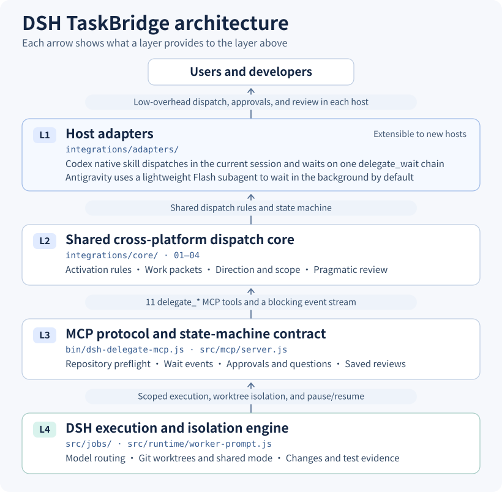

# DSH TaskBridge

**Keep architecture planning and final code review in your upper host. Delegate heavy coding and test loops to DeepSeek Harness (DSH) inside a clean black-box MCP bridge.**

> **Version `1.9.3` · Native one-click integration for Codex and Antigravity. Claude Code / Claude Desktop support is planned for 2.0.**  
> `1.9.3` introduces zero-destruction automatic post-acceptance worktree-to-source sync (`applyToSource: true` / `sourceSync`), refines Codex upfront contract briefs and single-call worker test approval boundaries, and sets new benchmark token-saving highs on both hosts; see [1.9.3 Release Notes (ZH)](releases/1.9.3.zh.md).

[简体中文](INTRODUCTION.zh.md) · [Why TaskBridge](#why-taskbridge) · [Benchmark Results & Token Savings](#benchmark-results--token-savings) · [Key Capabilities](#key-capabilities) · [Quick Start](#quick-start) · [How It Works](#how-it-works) · [FAQ](#faq) · [Changelog](../CHANGELOG.md)

**DSH TaskBridge** is a cross-host task delegation plugin for **DeepSeek Harness (DSH)**.
Stay inside your preferred upper host to inspect repositories, design interfaces, decompose multi-stage work, and review delivered diffs — while offloading verbose code generation and iterative test-fixing loops to cost-effective or custom models configured in DSH over 11 bounded `delegate_*` MCP tools.

To the host, execution is a **controlled black-box workshop**: API credentials, provider/model routing, reasoning effort, Git `worktree` isolation, cross-subtask worktree reuse, and native DSH sessions stay encapsulated inside the plugin. The host focuses strictly on **direction, boundary approvals, and pragmatic acceptance**.



## Why TaskBridge

Frontier reasoning models excel at system design and code review, yet burning their quota on boilerplate implementation and repetitive test debugging gets expensive fast — while manually copying prompts and diffs across windows quickly loses context. TaskBridge connects both sides through a four-layer architecture:

- **L1 Host-native zero-busy-wait adapters:**
  - **Codex (`1.9.0+` Native Skill):** Installs a compact entry `skills/dsh-taskbridge/SKILL.md` plus an on-demand reference appendix so the active Codex session calls `tools.mcp__dsh_delegate__*` directly in Code Mode (avoiding bulk `ALL_TOOLS` dumps) and drives a single `delegate_submit({ autoPreflight: true, wait: true })` + `delegate_wait` chain (`yield_time_ms: 1200000` with `tool_timeout_sec = 3660`), completely eliminating legacy `spawn_agent` + short-timeout `wait_agent` polling loops while safely retiring untouched legacy `.toml` subagents.
  - **Antigravity (Self-contained plugin bundle):** Offloads preflight, silent wait loops, and routine approvals to a lightweight `flash` background subagent so the flagship host model stays asleep until a compact structured delivery receipt is ready for review.
- **L2 Shared architect-style dispatch core:** Unified single-source rules across hosts — **decompose large multi-subsystem goals (`delegate_plan`) + steer architecture, exported contracts, and scope redlines (never dictating line-by-line code or pseudocode in prompts) + enforce pragmatic review (consolidate real spec/bug/test defects into one rework round; never invent out-of-spec fuzz probes)**.
- **L3 Bounded compact MCP protocol:** Single-line JSON payloads, one-call `autoPreflight` + `wait` submission, and diff-free local review receipts (`includeDiff: false` / `receiptOnly: true`).
- **L4 Isolated Git worktrees, zero-destruction sync & seamless continuations:** Runs in isolated Git worktrees by default; downstream multi-stage subtasks can reuse an accepted isolated worktree with a fresh DSH Session via `reuseWorktreeFromTaskId` without touching the user's source checkout; follow-up fixes resume the exact session via `continueFromTaskId`; passing `applyToSource: true` on the final `accepted` review automatically syncs verified changes back to `sourcePath` after conflict prechecks without auto-committing; linked cleanup removes histories, archived sessions, and temporary worktrees in one click.

---

## Benchmark Results & Token Savings

We evaluated **Antigravity (`1.9.1` → `1.9.3`)** and **Codex (`1.9.0` → `1.9.3`)** across a 7-task deterministic black-box benchmark suite (`T0A` non-dispatch chat boundary, `T0B` 3 invalid/uncommitted Git directory blocks, `T1` core quota-ledger implementation, `T2` tiered overage billing & audit report, `T3` discount engine & export CLI, `T4` dirty-checkout uncommitted draft preservation, and `T5` an enterprise 3-domain billing platform refactor with **235+ unit tests + 6 read-only SHA-256 fixture checks**), pairing each host against its own no-plugin strong-model baseline under identical fixtures and grading scripts. DSH ran `deepseek-v4.1-flash` as the worker.

### 1. Cross-Host Summary

| Host & Commander | Mode | Full Suite Passed | `T1–T5` Paired Passed | `T1–T5` Avg. Commander Turns | `T1–T5` Strong-Model Effective Tokens (Uncached In + Out) | Quota & Token Reduction | `T1–T5` Strong-Model Total Tokens (incl. Cache) | Auxiliary / DSH Worker Tokens |
| --- | --- | :---: | :---: | ---: | ---: | ---: | ---: | ---: |
| **Antigravity**<br>`gemini-4-neon-high` | No-plugin baseline | — | 5/5 (Avg. 100) | 11.00 | 618,861<br>*(Out: 191,677)* | Baseline | 3,276,639 | 0 |
| **Antigravity**<br>`gemini-4-neon-high` | **`1.9.3-test1`**<br>(`flash` subagent + auto-sync) | **7/7 (Avg. 100)**<br>*0 reworks* | **5/5 (Avg. 100)** | **10.00**<br>*(Below baseline; 7-task: 8.29)* | **374,844**<br>*(7-task: 436,350; Out: 67,985)* | **Saved 39.43%**<br>*(Output **-64.53%**; Total **-33.61%**)* | **2,175,330**<br>*(7-task: 2.35M, **-33.5%** vs 1.9.1)* | Flash aux: 1,725,982<br>+ DSH worker |
| **Codex CLI**<br>`gpt-6.2-sol (xhigh)` | No-plugin baseline | — | 4/5 (Avg. 96) | 11.20 | 608,065<br>*(Out: 66,816)* | Baseline | 1,966,145 | 0 |
| **Codex CLI**<br>`gpt-6.2-sol (xhigh)` | **`1.9.2` Code Mode Slimmed**<br>(`test3` isolated / `test4` manual sync) | **4× consecutive 7/7 (100)** | **5/5 (Avg. 100)**<br>*Exceeds 4/5 baseline* | 21.60–24.00<br>*(7-task: 113–126 turns)* | Out: 47,085–59,683<br>*(`custom` proxy eff: 1.20M–1.48M\*)* | Output -10.7% to -29.5%<br>*(Total tokens -34% to -44% vs 1.9.1)* | 6,274,024–7,350,171<br>*(7-task: 6.41M–7.51M)* | DSH worker |
| **Codex CLI**<br>`gpt-6.2-sol (xhigh)` | **`1.9.3-test1` / `test2`**<br>(source-graded after auto-sync) | **2× consecutive 7/7 (100)** | **5/5 (Avg. 100)**<br>*Exceeds 4/5 baseline* | **22.60–23.20**<br>*(7-task: **119–122 turns**; **0** manual sync cmds)* | **437,191–447,111**<br>*(7-task: 465k–467k; Out: **41,825–47,553**)* | **Saved 26.47%–28.10%**<br>*(Output **-28.83% to -37.40%**)* | **5,874,887–6,335,111**<br>*(7-task: **6.01M–6.46M**, all-time low)* | DSH worker |

> **Verification & channel notes:**
> 1. **Zero false dispatch, zero truncation & zero manual sync:** Both hosts answered `T0A` directly with zero dispatch calls and blocked all three invalid repository layouts on `T0B`. In `1.9.3`, every `worktree` task (`T1`, `T2`, `T3`, `T5`) synced back cleanly via `delegate_review(..., applyToSource: true)` and passed black-box grading directly against `sourcePath`, driving post-acceptance manual copy/re-test commands down to **`0`**.
> 2. **New cross-release highs on both hosts:** On Antigravity, `1.9.3` cut 7-task flagship total tokens by **33.5%** (`3.54M → 2.35M`) and effective tokens by another **12.6%** vs. `1.9.1`, achieving **+33.61% net total-token savings** (including cache reads) and fewer commander turns (`10.00` vs. `11.00`) than the no-plugin baseline. On Codex, `1.9.3` cut 7-task total tokens by **43.3%–47.3%** vs. the `1.9.1` full-pass run (`11.39M`) and **13.9%–20.0%** vs. the `1.9.2` manual-sync run (`7.51M`), while delivering **26.47%–28.10%** net effective-token savings on `T1–T5`.
> 3. **\*Transport cache-rate note:** The `1.9.2` runs used a WebSocket proxy channel (`79.6%–83.7%` cache hit rate), whereas the two `1.9.3` runs operated over HTTPS with normal `92.8%–93.5%` prompt-cache hit rates (matching `1.9.0` / `1.9.1`), setting new full-pass bests across both effective and total token metrics.

### 2. Per-Task Strong-Model Savings Breakdown (`1.9.3` vs. Same-Host Baseline, `T1–T5`)

| Task & Scope | Antigravity Baseline → `1.9.3` Effective | Antigravity `1.9.3` Savings | Codex Baseline → `1.9.3` Effective | Codex `1.9.3` Savings & Total Volume |
| --- | ---: | --- | ---: | --- |
| **`T4`** · Small dirty-repo fix preserving uncommitted drafts (7 tests) | 44,731 → 53,771 | -20.21% *(fixed overhead; output **-39.9%**)* | 81,590 → **54,843–69,548** | **+14.76%–32.78%**; total `0.62M–0.69M` *(**-32% to -39%** vs 1.9.2 synced)* |
| **`T1`** · Core quota-ledger implementation (20 tests) | 73,559 → **49,656** | **+32.50%** *(total **-10.7%**, output **-64.2%**)* | 52,768 → 74,412–88,534 | -41.02% to -67.78%; `test2` down to **`13` turns / `0.44M` total** *(**-38.4%** vs 1.9.2)* |
| **`T2`** · Tiered overage billing & audit report (39 tests) | 92,737 → **59,526** | **+35.81%** *(total **-27.1%**, output **-62.2%**)* | 100,570 → **53,646–57,122** | **+43.20%–46.66%**; full `100/100` (vs `80` baseline); total **`0.49M–0.55M`** |
| **`T3`** · Discount engine, ledger integration & CLI (51 tests) | 85,481 → **57,477** | **+32.76%** *(total **-32.4%**, output **-68.7%**)* | 82,885 → **79,831**–113,284 | `test2` **+3.68%** net savings; `test1` total `0.82M` (`20` turns) |
| **`T5`** · Enterprise 3-domain billing platform (235+ tests + 6 SHA-256 contracts) | 322,353 → **154,414** | **+52.10%** *(total **-44.6%**, output **-67.9%**, `15` turns)* | 290,252 → **141,006–152,076** | **+47.61%–51.42%** *(output **-55.3% to -60.3%**; total `3.23M–3.56M`)* |

### 3. Key Benchmark Conclusions

1. **Lightweight worker + strong host review achieves `7/7` (700/700) full pass on both hosts:** Even with a lightweight `deepseek-v4.1-flash` worker, clear upfront contract briefs combined with independent host verification delivered **7/7 (700/700)** across Antigravity (`1.9.3`, zero reworks) and six consecutive Codex `1.9.2`–`1.9.3` runs — consistently surpassing the `4/5` no-plugin Codex baseline on `T2`.
2. **Savings scale with task complexity (`47.6%–52.1%` effective savings and `55%–68%` output reduction on `T5`):** Multi-file features and cross-module refactors (`T1`, `T2`, `T3`, `T5`) offload heavy code output and test loops to DSH, cutting Antigravity `T1–T5` flagship output by **64.5%** and Codex `T1–T5` output by **28.8%–37.4%** (`T5` output **-55.3% to -60.3%**). Tiny single-point edits (`T1`/`T4` scale) carry fixed preflight/review overhead and can be edited directly in the host.
3. **Zero-destruction auto-sync closes the last mile and lowers total token volume on both hosts:** `applyToSource: true` eliminates manual post-review copy scripts and duplicate test runs in `sourcePath` — Antigravity cuts `T1–T5` flagship total tokens (including cache) **33.61% below** the no-plugin baseline (`2.18M` vs. `3.28M`), while Codex compresses 7-task total tokens down to **`6.01M–6.46M`** with **`26.5%–28.1%`** net effective savings.
4. **Trades background wall-clock time for flagship quota:** Under concurrency, `1.9.3` finishes the full 7-task suite (including `T5` and safe source write-back) in ~**27–46 minutes**, making it ideal for background or parallel worktree delegation.

---

## Key Capabilities

| Capability | What You Get |
| --- | --- |
| **One-click host integration** | Dedicated settings tabs for Codex and Antigravity to install, update, repair MCP only, or cleanly remove managed integrations (including automatic retirement of untouched legacy Codex `.toml` subagents) while preserving any user edits via SHA-256 content digests. |
| **Reuse DSH APIs, models & effort** | Select providers, worker models, and reasoning effort already configured in DSH; API keys never leave DSH. |
| **Plan trees, worktree reuse & linked cleanup** | Decompose multi-stage goals with `delegate_plan`; pass `reuseWorktreeFromTaskId` so dependent subtasks start a fresh DSH Session on an accepted isolated worktree; filter **Task history** by date, jump to native sessions, and clean task chains, archived sessions, and isolated worktrees in one click. |
| **Parallel worktree isolation & workspace tree** | Run isolated parallel Git worktrees (nested under DSH's `TaskBridge` sidebar root and titled per task) or explicit shared checkouts (preserving the project's native workspace name). |
| **Tiered silent monitoring** | No default total execution cap; runs one local read-only self-check 10 minutes after start, checks in with the host after 40 minutes without a new delivery, and deduplicates repeated tool-failure reminders (all configurable). |
| **Single-call approvals & native questions** | The host approves each out-of-sandbox call using its exact argument fingerprint. Native DSH questions forward and resume waiting in one call. |
| **Optional Agent Teams & project overrides** | `agentTeams` is off by default and configurable globally or per dispatch; settings auto-save with reusable presets and per-project path overrides. |

## Quick Start

### 1. Install in DSH

Open **Plugins → Add plugin** in DSH, install and enable:

```text
dsh-taskbridge
```

> Switch to the official npm registry if a regional mirror lags behind, or install a `.tgz` archive from [GitHub Releases](https://github.com/ranranyya/dsh-taskbridge/releases). Requires Node.js 24+ (automatically resolved without ever writing the Electron GUI executable).

### 2. Configure the Worker Model

1. Open **Plugins → Installed plugins → dsh-taskbridge → API management** and enable a DSH provider.
2. Open **Execution settings** and pick the provider, worker model, and supported reasoning effort.
3. Confirm changes show as saved.

### 3. Connect Your Host

- **Codex:** Open **Codex integration** and click **Install / update TaskBridge skill** (writes `skills/dsh-taskbridge/SKILL.md`, its rules reference appendix, and `config.toml` MCP entry while retiring untouched legacy `agents/dsh-taskbridge.toml`). Start a new Codex session and dispatch with `$dsh-taskbridge` or an explicit DSH / TaskBridge instruction.
- **Antigravity:** Open **Antigravity integration** and click **Install / update Antigravity plugin** (installed cleanly under `~/.gemini/config/plugins/dsh-taskbridge/`). Dispatch with `@[plugin:dsh-taskbridge]` / `@dsh-taskbridge` or an explicit instruction; select **Always Allow** on the first `delegate_*` prompt so background waiting runs uninterrupted.

### 4. Enable the Switch and Dispatch

Turn on **Allow local MCP calls to DSH delegation** at the top of the settings page (off by default), then assign a task from your host:

> Use TaskBridge to have DSH implement the tiered overage billing module and export CLI in this repository. Inspect the specs first, define the module contracts and boundaries, dispatch the implementation and unit tests to DSH, and review the delivered diff and test suite before accepting.

## How It Works

### Isolation Modes

- **Independent worktree (`worktree`, default):** Branches an isolated Git worktree from `HEAD` under DSH's `TaskBridge` sidebar node; multi-stage subtasks can chain onto the same isolated worktree with clean sessions via `reuseWorktreeFromTaskId`.
- **Shared workspace (`shared`):** Runs in place inside a dirty checkout only after explicit preflight confirmation; reuses the project's native workspace and is strictly protected from linked cleanup deletion.

> **Git repository requirement:** Both modes require an initialized Git repository root with at least one commit. Recording `accepted` via `delegate_review` never auto-commits or pushes; in `worktree` mode, passing `applyToSource: true` on the final `accepted` review automatically syncs verified changes back to your source checkout after zero-destruction conflict prechecks (reporting any conflicting paths with zero bytes modified).

### Quiet Waiting & Monitoring

- **10 minutes after start (default):** One read-only local self-check with zero LLM cost.
- **40 minutes with no new delivery (default):** Returns a compact progress check-in to `delegate_wait` without cancelling the run.
- **Repeated identical tool failures (default: 3):** Surfaces an acknowledged `eventId` reminder to prevent runaway loops. See [Silent waiting](silent-wait.md).

## FAQ

**Does installing TaskBridge send ordinary chat or code questions to DSH?**
No. Both the local delegation switch AND an explicit assignment of a Git-repository implementation/verification task are required. General Q&A stays directly in the host with zero tool calls.

**Will updates overwrite my edits to `SKILL.md` or legacy `dsh-taskbridge.toml`?**
No. Ownership is proved by SHA-256 content digests; customized files are preserved verbatim. Use **Repair MCP only** to refresh just the MCP entry.

**When should I delegate vs. edit directly in the host?**
Edit tiny one-file tweaks directly in the host. Delegate multi-file features, test suites, CLI/service modules, and cross-domain refactors to TaskBridge to save flagship model effective tokens while maintaining full review control.

## Host Support & Roadmap

| Host | Status | Integration |
| --- | --- | --- |
| **Codex** | Supported (`1.9.0` Native Skill) | One-click `skills/dsh-taskbridge/SKILL.md` + reference appendix + MCP (auto-retires untouched legacy subagents) |
| **Antigravity** | Supported | One-click self-contained plugin (`plugins/dsh-taskbridge/`: Skill + `flash` Subagent + MCP) |
| **Claude Code / Claude Desktop** | Planned (`2.0`) | Shares the same layered dispatch core and MCP surface; see [Claude roadmap](claude-code.md) |

## Documentation & Feedback

- [1.9.3 Release Notes (ZH)](releases/1.9.3.zh.md) · [1.9.2 Release Notes (ZH)](releases/1.9.2.zh.md) · [1.9.1 Release Notes (ZH)](releases/1.9.1.zh.md) · [1.9.0 Release Notes (ZH)](releases/1.9.0.zh.md) · [Codex integration](codex-integration.md) · [Antigravity integration](antigravity-integration.md) · [Claude roadmap](claude-code.md)
- [Silent waiting](silent-wait.md) · [Workspace isolation](workspace-contract.md) · [Conversation placement](conversation-placement.md)
- [Runtime compatibility](runtime-compatibility.md) · [Plugin market](plugin-market.md) · [Legacy migration](taskbridge-upgrade.md)

Report issues or suggestions on [GitHub Issues](https://github.com/ranranyya/dsh-taskbridge/issues) with your plugin version, reproduction steps, and redacted diagnostics (never include API keys).

## License

[MIT](../LICENSE)
