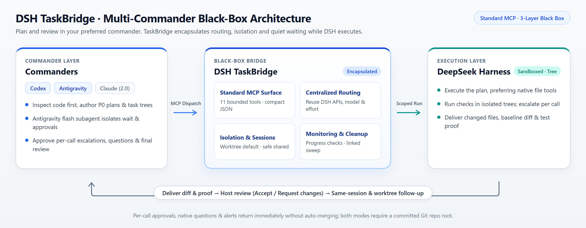

# DSH TaskBridge

**Plan and review in your favorite commander. Delegate the implementation to DeepSeek Harness (DSH).**

> **Supports Codex and Antigravity out of the box. Claude Code and Claude Desktop integration is planned for 2.0.**

[简体中文](INTRODUCTION.zh.md) · [Quick start](#quick-start) · [Key capabilities](#key-capabilities) · [How it works](#how-it-works) · [FAQ](#faq) · [Changelog](../CHANGELOG.md)

TaskBridge is a multi-client task delegation plugin for **DeepSeek Harness (DSH)**.
Keep designing, breaking down work and reviewing diffs inside **Codex** or **Antigravity**, while letting the model configured in DSH edit files, run tools and verify tests over a clean, standard MCP interface.

Execution stays a **black box** to the commander: API connections, worker model, reasoning effort, Git worktree isolation and DSH native workspaces/sessions are managed inside the TaskBridge plugin. The commander focuses purely on planning, per-operation approvals and final review.



## Why TaskBridge

When you want Codex or Antigravity to drive architecture and code review, while delegating implementation to models already connected in DSH, copying prompts and diffs back and forth breaks down fast. TaskBridge bridges the two cleanly:

- **Clean layered black-box architecture:** Configure provider, model and reasoning effort once in DSH. Every commander talks to the same standard MCP surface (11 bounded tools, compact single-line JSON payloads) without leaking low-level routing or workspace details into prompts.
- **Plan before dispatch:** The commander inspects code first and sends a concrete implementation brief and acceptance criteria (or builds a multi-step plan tree). DSH executes the plan using native file/search tools first and reports evidence back if a premise conflicts with the repository.
- **Quiet waiting with low commander overhead:** A local wait loop tracks real worker activity without busy polling, and Antigravity delegates wait & routine approval loops to a lightweight `flash` background subagent so flagship context stays clean.
- **Same-session follow-ups:** Review diffs and test evidence together, record an explicit accept or rework verdict, and send consolidated fixes right back to the original DSH session and worktree.
- **Isolated parallel runs & linked cleanup:** Default Git worktree isolation lets one project run multiple independent work packets in parallel, and **Task history** offers preset selection, linked worktree/session/plan cleanup, `interrupted` record removal and orphan residual sweeps.

## Key capabilities

| Capability | What you get |
| --- | --- |
| **Codex & Antigravity one-click setup** | Dedicated settings tabs to install, update, repair MCP only, or cleanly remove managed integrations while preserving any user edits via content digests. |
| **Reuse DSH APIs & models** | Pick from providers already enabled in DSH with your chosen worker model and reasoning effort; credentials stay inside DSH. |
| **Task trees, history & linked cleanup** | Plan multi-level goals and subtasks; filter task records by date, batch-select with presets (`All`, `Accepted`, `Failed / Cancelled / Interrupted`), inspect full review notes, jump to the native DSH session, and optionally archive sessions, remove isolated worktrees/workspaces, clean empty plan ancestors and sweep historical orphans (never touching source files or shared workspaces). |
| **Worktree isolation & workspace tree** | Run isolated parallel worktrees (nested automatically under DSH's `TaskBridge` sidebar root and titled per task) or explicit shared checkouts (reusing the project's native workspace and keeping its original name), with lightweight badges on dispatched sessions. |
| **Tiered silent monitoring** | No default total execution timeout. By default, a one-time local self-check runs 10 minutes after execution starts, and a commander check-in triggers after 40 minutes with no new delivery — plus deduplicated repeated-failure reminders (all adjustable or toggleable). |
| **Per-operation approvals & native questions** | Commands beyond workspace write require exact-fingerprint commander approval for that single call (omitting bulky monitoring blobs during interactive pauses); native DSH questions forward cleanly and resume waiting in one call. |
| **Optional Agent Teams** | Off by default; configurable as a new-task default or per dispatch, with continuations inheriting the chain's choice. |
| **Auto-save, presets & project overrides** | Changes save automatically; store reusable worker presets and per-project overrides. |

## Quick start

### 1. Install in DSH

Open **Plugins → Add plugin** in DSH, install and enable:

```text
dsh-taskbridge
```

> Switch to the official npm registry if a regional mirror lags behind, or install a `.tgz` archive from GitHub Releases. The local MCP bridge requires Node.js 24+ (automatically resolved by the integration installer without ever pointing at the Electron GUI binary).

### 2. Choose your worker model

1. Open **DSH TaskBridge Settings → API management** and add an enabled DSH provider.
2. Open **Execution settings** and choose the provider, worker model and supported reasoning effort.
3. Confirm the page shows a saved status before dispatching.

### 3. Connect a commander

- **Codex:** Open **Codex integration** and click **Install / update TaskBridge agent**, then reload Codex and dispatch by naming `dsh-taskbridge` (or explicitly assigning the task to DSH / TaskBridge).
- **Antigravity:** Open **Antigravity integration** and click **Install / update Antigravity plugin**. This installs a self-contained bundle under `~/.gemini/config/plugins/dsh-taskbridge/` (`plugin.json`, on-demand `SKILL.md`, lightweight background dispatcher subagent, and plugin-scoped `mcp_config.json`) without modifying your global Antigravity config. When Antigravity prompts for external MCP confirmation on the first `delegate_*` call, choose **Always Allow** so quiet waiting is not interrupted.

### 4. Flip the switch and dispatch

Enable **Allow local MCP calls to DSH delegation** at the top of the settings page (off by default). Then assign a task from Codex or Antigravity, for example:

> Use TaskBridge to have DSH fix the autosave draft-loss bug in this repository. Inspect the code first, write a clear implementation plan limited to the save queue, add regression tests, and review the delivered diff and test results.

Follow execution live in DSH's workspace sidebar and review delivery records in **Task history**.

## How it works

The settings page has a top delegation switch and five tabs: **API management, Execution settings, Task history, Codex integration, and Antigravity integration**.

### Isolation modes

- **Independent worktree (default):** Creates an isolated Git worktree from the committed baseline so candidate edits stay separate and independent tasks can run in parallel; automatically nested under DSH's `TaskBridge` sidebar node and named after the task title.
- **Shared workspace:** Runs directly inside the authorized checkout when uncommitted changes exist and in-place execution is explicitly approved after preflight; reuses the project's own native DSH workspace, preserves its original name, and is strictly protected from linked cleanup deletion.

> **Git repository requirement:** Both **worktree** and **shared** modes require an initialized Git repository root with at least one commit (general non-code Q&A or plain folders are not dispatched through TaskBridge). Accepting a review records your conclusion only — it never merges a worktree, commits or pushes automatically.

### Quiet waiting & monitoring

- **Quiet local wait:** During normal execution, the local wait loop observes the run silently without asking the commander to poll or read in-progress files.
- **10 minutes after execution starts (default):** Runs **one** read-only local self-check per run (no commander model call); ongoing worker activity does not postpone it.
- **40 minutes with no new delivery to the commander (default):** Sends a concise progress diagnosis to the commander without cancelling the task. Even if DSH is actively working, this check-in still fires if no new result has been delivered back within 40 minutes.
- **Repeated identical tool failures (default threshold: 3):** Sends an acknowledged reminder so loops do not burn tokens unchecked.

The two clocks measure different boundaries (**execution start** vs. **time since last delivery** — internal model steps, tool calls, heartbeats and self-check readings do not reset the 40-minute clock). Neither is a hard execution timeout, and healthy runs are never killed by a default cap. See [Silent waiting](silent-wait.md).

## FAQ

**Does installing TaskBridge make Codex or Antigravity send everything to DSH automatically?**
No. Dispatch only happens when the local delegation switch is enabled AND you explicitly assign a Git-repository code/verification task to DSH / TaskBridge. General Q&A (even if `@dsh-taskbridge` is mentioned) stays in the commander.

**Will plugin updates overwrite my custom edits to `dsh-taskbridge.toml` or `SKILL.md`?**
No. Ownership is verified by content digest: unmodified plugin-managed files refresh automatically on upgrade, while customized files are preserved and reported. Use **Repair MCP only** to refresh just the MCP connection.

**Does the Antigravity integration touch my global `mcp_config.json` or `config.json`?**
No. Everything lives inside `~/.gemini/config/plugins/dsh-taskbridge/` so Antigravity can enable, disable or remove it cleanly as one unit.

**How does TaskBridge reduce commander token usage?**
Planning, approvals, questions and final review still use the commander, while TaskBridge cuts overhead at three layers: (1) quiet local waiting with no intermediate polling; (2) Antigravity defaults to a lightweight `flash` background subagent for wait & approval loops, returning only a concise summary to the flagship model; and (3) worker prompts prefer native file/search tools over shell commands, paired with compact single-line JSON MCP responses that trim bulky monitoring blobs during interactive pauses.

## Client support & roadmap

| Client | Status | Integration |
| --- | --- | --- |
| **Codex** | Supported | One-click managed companion (`agents/dsh-taskbridge.toml`) + MCP entry |
| **Antigravity** | Supported | One-click self-contained plugin (`plugins/dsh-taskbridge/`: Skill + Subagent + MCP) |
| **Claude Code / Claude Desktop** | Planned (2.0) | Shares the same standard MCP interface; see [Claude roadmap](claude-code.md) |

## Documentation & feedback

- [Codex integration](codex-integration.md) · [Antigravity integration](antigravity-integration.md) · [Claude roadmap](claude-code.md)
- [Silent waiting](silent-wait.md) · [Workspace isolation](workspace-contract.md) · [Conversation placement](conversation-placement.md)
- [Runtime compatibility](runtime-compatibility.md) · [Plugin market](plugin-market.md) · [Legacy migration](taskbridge-upgrade.md)

Report issues or share suggestions on [GitHub Issues](https://github.com/ranranyya/dsh-taskbridge/issues) with your plugin version, steps to reproduce and redacted diagnostics (never include API keys).

## License

[MIT](../LICENSE)
