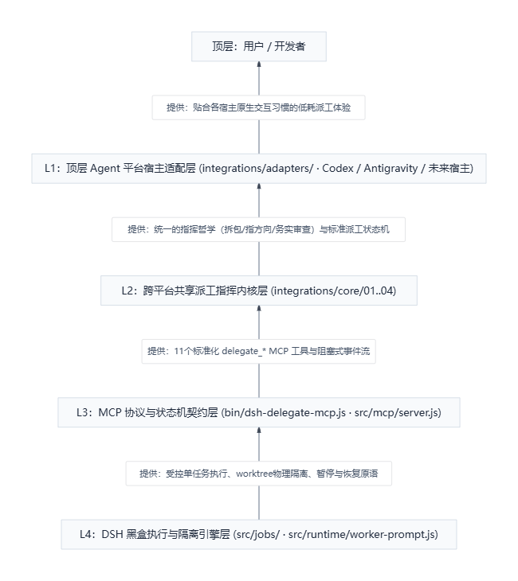

# DSH TaskBridge

**让 Codex 与 Antigravity 专注架构规划与验收把关，把重度写代码和跑测试交给 DeepSeek Harness（DSH）在独立 Git worktree 中并行干活。**

> **当前版本 `1.9.4` · 已原生支持 Codex 与 Antigravity 一键集成；Claude Code / Claude Desktop 接入计划于 2.0 上线。**  
> 本次 `1.9.4` 零破坏将 MCP 握手与工具目录上下文直降 **75%–87%**（`45.5K → 11.4K` 字符，新增上限锁测），同步清理前端零调用死组件与内部未发布测试哈希，详见 [1.9.4 更新说明](releases/1.9.4.zh.md)。

[English](INTRODUCTION.md) · [快速上手](#快速上手) · [双端基准测试与省流实测](#双端基准测试与省流实测) · [为什么选择 TaskBridge](#为什么选择-taskbridge) · [核心能力](#核心能力) · [设置与机制](#设置与机制) · [常见问题](#常见问题) · [更新日志](../CHANGELOG.md)

在 **Codex** 或 **Antigravity** 中阅读仓库、拆解架构、设定接口契约并独立验收交付，将耗费大量输出与反复跑单测排错的编码任务交给 **DeepSeek Harness（DSH）** 执行：

- **实测省下可观主力配额，且 `7/7` 全满分不降质**：`T1–T5` 合计旗舰模型有效 Token **净省 `26.5%–39.4%`**（Antigravity 含缓存总流量净省 **`33.61%`**），重型三域重构单题 `T5` 有效省流达 **`47.6%–52.1%`、代码输出直降 `55%–68%`**；`1.9.4` 压缩 `75%–87%` MCP 工具目录后，Codex `T0A–T4` 六题满分复验连小型题 `T1` 也首次反超无插件基线（有效 `45,033`，净省 **`+14.66%`**）、`T3` 有效降至 **`60,047`**（净省 **`+27.55%`**）。
- **独立 Git `worktree` 真并行隔离 + 验收后零破坏写回**：默认隔离并行开发、不污染当前分支或草稿，终局验收通过后经冲突预检一键安全写回原工作区（绝不自动 `git commit`）。
- **静默长等免轮询 + 敏感操作逐次指纹审批**：单次调用静默长等 20–60 分钟免轮询，DSH 原生侧栏全程实时可见，越界命令按真实参数指纹逐次审批。



## 为什么选择 TaskBridge

当你信任高阶旗舰模型（如 GPT / Gemini 高推理档位）的架构设计与代码审查能力，但不想让它在样板代码编写和反复跑单测排错上烧掉宝贵配额，同时又厌倦了在多个窗口间手工粘贴提示词与 diff 时，TaskBridge 通过四层架构直接打通协同闭环：

- **L1 宿主因地制宜，零空转等待**：
  - **Codex 端（1.9.0+ 原生技能）**：安装紧凑入口 `skills/dsh-taskbridge/SKILL.md` 与按需读取附页，在 Code Mode 下直接调用 `tools.mcp__dsh_delegate__*`（免整组打印 `ALL_TOOLS` 防截断）并驱动 `delegate_submit({ autoPreflight: true, wait: true })` + 单链 `delegate_wait`（全链路 `yield_time_ms: 1200000` 配合 `tool_timeout_sec = 3660` 静默长等），彻底根除旧版 `spawn_agent` + 短超时 `wait_agent` 的高频轮询空转，并自动安全退役未修改的旧 `.toml` 子智能体。
  - **Antigravity 端（自包含插件包）**：默认将预检、等待循环与常规权限审批卸载给轻量 `flash` 后台子智能体托管，主旗舰模型零唤醒挂起，仅在交付后接收精简结构化证据完成最终审查。
- **L2 架构师式派工，杜绝代写与洁癖返工**：双端共享单一真源派工内核——**大任务拆小包（`delegate_plan`）+ 指明架构骨架、接口契约与范围红线（严禁宿主端在提示词中代写逐行实现代码或伪代码）+ 务实独立审查（仅对违背规范、真 Bug、测试失败或越界残留合并一轮打回，拒绝超纲假设空耗）**。
- **L3 紧凑有界 MCP 协议**：支持预检、提交与首段等待合并为一次调用。单行 JSON 载荷支持在本地审查时省略补丁正文或只返回回执（`includeDiff: false` / `receiptOnly: true`）。
- **L4 Git 工作树并行隔离、零破坏自动写回与无缝续接**：默认从干净基线拉出独立 `worktree` 并行执行；多阶段下游子包可通过 `reuseWorktreeFromTaskId` 在同一隔离工作树上开启全新干净 DSH 会话（全程不污染主仓库）；同一任务返工通过 `continueFromTaskId` 原会话续接；终局 `accepted` 传入 `applyToSource: true` 即可通过冲突预检后自动写回原工作区（绝不自动 `git commit`），完成后支持按任务链一键联动清理。

---

## 双端基准测试与省流实测

我们使用覆盖 7 类真实工程场景的跨宿主黑盒基准套件（`T0A` 非指派静默边界、`T0B` 三类非法/未提交 Git 目录只读拦截、`T1` 配额账本核心实现、`T2` 超额计费与审计报告、`T3` 折扣集成与导出 CLI、`T4` 脏工作区未提交草稿完整性保护、`T5` 含 **235+ 项单测 + 6 份只读契约 SHA-256 校验**的企业级三域计费平台重构），在相同初始靶场与统一独立黑盒阅卷脚本下，对 **Antigravity（`1.9.1` → `1.9.3`）** 与 **Codex（`1.9.0` → `1.9.3` 演进实测）** 进行了同宿主无插件直做基线对照。插件组 DSH 执行后端统一采用轻量模型 `deepseek-v4.1-flash`。

### 1. 双端综合实测总览

| 宿主端与主控配置 | 运行模式 | 全集通过（得分） | `T1–T5` 同题通过 | `T1–T5` 主控均步 | `T1–T5` 强模型有效 Token（非缓存输入 + 输出） | 强模型省流与减负成效 | `T1–T5` 强模型含缓存总 Token | 辅助 / DSH 执行端 Token |
| --- | --- | :---: | :---: | ---: | ---: | ---: | ---: | ---: |
| **Antigravity**<br>`gemini-4-neon-high` | 无插件直做基线 | — | 5/5（均分 100） | 11.00 | 618,861<br>*(输出 191,677)* | 基线 | 3,276,639 | 0 |
| **Antigravity**<br>`gemini-4-neon-high` | **`1.9.3-test1`**<br>（`flash` 子智能体 + 自动写回） | **7/7（均分 100）**<br>*全程 0 返工* | **5/5（均分 100）** | **10.00**<br>*(低于基线；7 题 8.29)* | **374,844**<br>*(7 题 436,350；输出 67,985)* | **有效净省 39.43%**<br>*(强模型输出省 **64.53%**；含缓存总流量省 **33.61%**)* | **2,175,330**<br>*(7 题 235.4 万，较 1.9.1 降 **33.5%**)* | Flash 辅助 1,725,982<br>+ DSH 后端执行 |
| **Codex CLI**<br>`gpt-6.2-sol (xhigh)` | 无插件直做基线 | — | 4/5（均分 96） | 11.20 | 608,065<br>*(输出 66,816)* | 基线 | 1,966,145 | 0 |
| **Codex CLI**<br>`gpt-6.2-sol (xhigh)` | **`1.9.2` Code Mode 减负版**<br>（`test3` 隔离 / `test4` 手工写回） | **连续 4 轮 7/7（均分 100）** | **5/5（均分 100）**<br>*超越基线 4/5* | 21.60–24.00<br>*(7 题 113–126 步)* | 输出 47,085–59,683<br>*(转发通道有效 1.20M–1.48M\*)* | 主控输出省 10.7%–29.5%<br>*(较 1.9.1 满分场总 Token 降 34%–44%)* | 6,274,024–7,350,171<br>*(7 题 641 万–751 万)* | DSH 后端执行 |
| **Codex CLI**<br>`gpt-6.2-sol (xhigh)` | **`1.9.3-test1` / `test2`**<br>（自动写回后在源目录验收） | **连续 2 轮 7/7（均分 100）** | **5/5（均分 100）**<br>*超越基线 4/5* | **22.60–23.20**<br>*(7 题 **119–122 步**，验收后手写脚本 **0**)* | **437,191–447,111**<br>*(7 题 46.5 万–46.7 万；输出 **41,825–47,553**)* | **有效净省 26.47%–28.10%**<br>*(主控输出省 **28.83%–37.40%**)* | **5,874,887–6,335,111**<br>*(7 题 **600.6 万–646.3 万**，历史最低)* | DSH 后端执行 |

> **核验与演进口径说明**：
> 1. **零误触发、零截断与零手写同步**：`T0A` 普通非代码问答双端均零派工直接作答，`T0B` 三类不合规仓库均被只读预检精准拦截；`1.9.3` 在全部 `worktree` 题目（`T1`、`T2`、`T3`、`T5`）均由 `delegate_review(..., applyToSource: true)` 一次性零冲突同步回原工作区并通过源仓库直接阅卷，验收后手写拷贝脚本与重跑测试回合全部清零为 **`0`**。
> 2. **双端跨代再创新高**：Antigravity 端相比 `1.9.1`（7 题总 Token `353.9 万`、有效 `49.9 万`），`1.9.3` 将强模型含缓存总 Token 压降 **33.5%**（`235.4 万`）、有效 Token 再降 **12.6%**，首次在 `T1–T5` 上实现**含缓存总流量较无插件基线净省 `33.61%`**（主控均步 `10.00` 比无插件基线 `11.00` 更少）；Codex 端相比 `1.9.1` 首个 `7/7` 满分场（`179` 步 / `1,139.2 万` 总 Token）将含缓存总 Token 压降 **43.3%–47.3%**，相比 `1.9.2` 含手工写回场（`751.1 万`）再降 **13.9%–20.0%**，同时实现 `T1–T5` 强模型有效 Token **净省 `26.47%–28.10%`**。
> 3. **\*传输通道缓存率说明**：`1.9.2` 四轮运行于 WebSocket 自定义转发通道（缓存命中率 `79.6%–83.7%`），而 `1.9.3` 两轮通过 HTTPS 通道获得 `92.8%–93.5%` 正常缓存命中率（与 `1.9.0` / `1.9.1` 同级），使主控有效省流率与含缓存总流量双双创下 Codex 满分场最优纪录。

### 2. `T1–T5` 分题强模型省流明细（`1.9.3` vs 同宿主无插件基线）

| 题目与工程特征 | Antigravity 基线 → `1.9.3` 有效 Token | Antigravity `1.9.3` 省流成效 | Codex 基线 → `1.9.3` 有效 Token | Codex `1.9.3` 省流与总量表现 |
| --- | ---: | --- | ---: | --- |
| **`T4`** · 脏仓库小型增量修复（保留未提交草稿） | 44,731 → 53,771 | -20.21% *(小任务固定预检开销，输出仍省 **39.9%**)* | 81,590 → **54,843–69,548** | **+14.76%–32.78%**；总 Token `61.8 万–68.8 万` *(较 1.9.2 写回场降 **32%–39%**)* |
| **`T1`** · 配额账本核心模块实现（20 项单测） | 73,559 → **49,656** | **+32.50%** *(含缓存总 Token 净省 **10.7%**，输出省 **64.2%**)* | 52,768 → 74,412–88,534 | -41.02% 至 -67.78%；`test2` 压至 **`13` 步 / `44.3 万` 总 Token** *(较 1.9.2 写回场降 **38.4%**)* |
| **`T2`** · 分层超额计费与审计报告（39 项单测） | 92,737 → **59,526** | **+35.81%** *(含缓存总 Token 净省 **27.1%**，输出省 **62.2%**)* | 100,570 → **53,646–57,122** | **+43.20%–46.66%**；满分 `100` 超越基线 `80` 分，总 Token **`49.3 万–54.5 万`** |
| **`T3`** · 折扣引擎、账本集成与导出 CLI（51 项单测） | 85,481 → **57,477** | **+32.76%** *(含缓存总 Token 净省 **32.4%**，输出省 **68.7%**)* | 82,885 → **79,831**–113,284 | `test2` **+3.68%** 首次反超基线；`test1` 总 Token `81.5 万`（`20` 步） |
| **`T5`** · 企业级三域计费平台重构（235+ 项单测 + 6 契约校验） | 322,353 → **154,414** | **+52.10%** *(含缓存总 Token 净省 **44.6%**，输出省 **67.9%**，仅 `15` 步)* | 290,252 → **141,006–152,076** | **+47.61%–51.42%** *(主控输出净省 **55.3%–60.3%**，总 Token `322.7 万–355.8 万`)* |

### 3. 四点实测结论与选型建议

1. **轻量模型执行 + 强主控验收，双端均稳定拿到 `7/7`（700/700）全满分**：尽管执行端使用的是轻量高性价比模型（`deepseek-v4.1-flash`），依靠宿主端在派工前定清接口契约与防坑边界、交付后在隔离工作树独立跑测验收并按需原会话续修，Antigravity（`1.9.3` 全程零返工）与 Codex（`1.9.2`–`1.9.3` 连续六轮全集）均实现 **7/7 全满分通过**，Codex 插件组在 `T2` 上持续超越无插件基线（`100` vs `80`）。
2. **任务越复杂，主力模型配额省得越显著（重型架构题 `T5` 双端有效省流 `47.6%–52.1%`、代码输出省 `55%–68%`）**：在 `T1`、`T2`、`T3`、`T5` 等多文件开发与跨模块重构中，大段实现代码输出与反复跑测排错被卸载至 DSH，Antigravity `T1–T5` 强模型输出直降 **64.5%**，Codex `T1–T5` 主控输出直降 **28.8%–37.4%**（`T5` 单题输出省 **55.3%–60.3%**）；而几分钟可改完的极小单点修改（如 `T1`/`T4` 级别的小修补）存在固定预检与审查往返开销，可直接在宿主端顺手完成。
3. **零破坏自动写回打通最后一公里，双端含缓存总流量同步创新低**：`1.9.3` 的 `applyToSource: true` 消除了验收后宿主端手写同步脚本与重复跑测开销——Antigravity 依托 `flash` 后台子智能体隔离等待与常规审批，`T1–T5` 强模型含缓存总 Token 较无插件基线**净省 `33.61%`**（`217.5 万` vs `327.7 万`）；Codex 单链直调模式下 7 题含缓存总 Token 进一步压降至 **`600.6 万–646.3 万`**，有效省流稳定在 **`26.5%–28.1%`**。
4. **以适度后台墙钟耗时换取主力旗舰配额**：7 题全并发下 `1.9.3` 端到端约 **27–46 分钟**一气呵成完成开发、审查与源仓库安全写回（含重型三域重构题 `T5`），非常适合在后台或多工作树并行场景下派发中大型编码包，把宝贵的旗舰模型配额留给架构决策与代码把关。

---

## 核心能力

| 能力 | 说明 |
| --- | --- |
| **宿主端一键集成** | 设置页分别提供 Codex（原生技能 `skills/dsh-taskbridge/SKILL.md` + 按需附页 + MCP，自动安全退役未修改的旧版 `.toml` 子智能体）和 Antigravity（自包含插件包 + Skill + 轻量后台子智能体 + MCP）的安装、更新、仅修复 MCP 与卸载入口，按内容哈希完整保护用户自定义修改。 |
| **复用 DSH 已有 API、模型与思考强度** | 直接选用 DSH 已启用的接口、执行模型与思考强度；API 密钥全程留在 DSH 内，不导出、不回显。 |
| **任务树拆解、跨包工作树复用与联动清理** | 支持 `delegate_plan` 规划多层任务树；下游依赖子包可通过 `reuseWorktreeFromTaskId` 直接复用上游已验收隔离 `worktree` 并开启干净新会话；「任务记录」支持日期筛选、快捷预设勾选、查看完整审查意见、一键跳转原生会话及整链联动清理（严保主项目源码与共享工作区）。 |
| **隔离并行与原生工作区整合** | 默认独立 Git 工作树隔离（支持同项目多任务并行，自动归拢于 DSH 侧栏 `TaskBridge` 节点下并按任务标题命名），也支持预检确认后在脏仓库共享执行（保留项目原工作区名称）。 |
| **分级静默监控** | 普通任务无默认总执行时长上限；默认开始运行满 10 分钟本机只读自检一次、连续 40 分钟未回传新成果时提醒宿主端检查，连续同类工具失败（默认 3 次）带事件 ID 去重提醒（均可调或关闭）。 |
| **精确指纹单次审批与原生提问** | 超出常规工作区写权限的操作逐次审批，并核验本次调用的完整参数指纹。DSH 原生提问直传宿主端，答复后在同一次调用中续等。 |
| **可选智能体团队协作与项目覆盖** | `agentTeams` 默认关闭，支持全局默认或按单次派工显式指定（续接自动继承）；设置改动即时/防抖自动保存，支持常用预设与按项目路径独立覆盖配置。 |

## 快速上手

### 1. 在 DSH 中安装并启用插件

打开 DSH 的 **插件（Plugins manager）→ 添加插件**，输入包名安装并启用：

```text
dsh-taskbridge
```

> 若区域镜像尚未同步最新版，可切换 npm 官方源，或从 [GitHub Releases](https://github.com/ranranyya/dsh-taskbridge/releases) 下载 `.tgz` 本地安装。本机 MCP 服务运行在 Node.js 24+ 上，安装器会自动绑定真实 Node 运行时（绝不误写桌面端 GUI 可执行文件）。

### 2. 选定 DSH 执行模型

1. 打开 **Plugins → Installed plugins → dsh-taskbridge** 进入配置页，在 **接口管理** 中勾选已启用的 DSH 提供方。
2. 切换到 **执行设置**，选择执行提供方、执行模型与模型支持的思考强度。
3. 确认页面提示已自动保存。

### 3. 一键接入你的宿主端

- **接入 Codex**：打开 **Codex 集成** 页签，点击 **安装 / 更新 TaskBridge 技能**（自动写入 `skills/dsh-taskbridge/SKILL.md`、同目录规则附页与 `config.toml` MCP 配置，并安全清理未修改过的旧版 `agents/dsh-taskbridge.toml`）。重开或新建 Codex 会话后，输入 `$dsh-taskbridge` 或明确交代“交给 DSH / TaskBridge 执行”即可激活单链直等派工。
- **接入 Antigravity**：打开 **Antigravity 集成** 页签，点击 **安装 / 更新 Antigravity 插件**（独立写入 `~/.gemini/config/plugins/dsh-taskbridge/`，不触碰全局配置）。加载后通过 `@[plugin:dsh-taskbridge]` / `@dsh-taskbridge` 或明确指令派工；首次弹出外部 `delegate_*` 工具确认框时建议勾选 **Always Allow**，保持后台静默等待连贯。

### 4. 60 秒连通首检与正式派工

开启配置页顶部的 **允许本机 MCP 调用 DSH 委派**（新安装默认关闭，关闭即拒收新单并中止在途运行），先在已提交 Git 仓库中发一句只读自检确认接通：

> 请使用 dsh-taskbridge 检查本机委派开关状态，并对当前仓库做一次只读预检，不要提交执行任务。

宿主返回 `enabled: true` 及 `isolation: "worktree"`（`PREFLIGHT_CLEAN_REPOSITORY`）即确认接通；随后派发正式开发需求（执行过程可在 DSH 侧边栏 **`TaskBridge`** 分组或 **任务记录** 页签实时查看）：

> 用 TaskBridge 把当前仓库的分层超额计费模块和导出 CLI 交给 DSH 实现。你先核对现有目录与规范定好接口契约和边界，拆包或单包派给 DSH 完成编码与单测；交付后独立核验 diff 与测试结果并记录验收结论，若有缺陷就续接原任务修完。

## 设置与机制

### 独立工作树 vs 共享工作区

| 模式 | 修改落点与会话组织 | 适用场景 |
| --- | --- | --- |
| **独立工作树（`worktree`，默认）** | 从已提交基线拉出隔离工作树，折叠在 DSH 侧栏 `TaskBridge` 节点下并按任务标题命名；多阶段依赖子包可通过 `reuseWorktreeFromTaskId` 在同一隔离树上开启新会话接力开发 | 希望改动与主工作区完全隔离、同仓库多任务并行推进，待全部验收通过后再合入主分支；联动清理可一并移除工作树与临时工作区。 |
| **共享工作区（`shared`）** | 经预检确认后直接在授权项目目录内修改，沿用项目原生工作区并保留原名称 | 当前仓库已有未提交草稿且确认原地协作安全；联动清理严格保护源码目录与共享工作区不被删除。 |

> **仓库硬前提**：两种模式均要求目标路径是**已初始化且至少有 1 次 commit 的 Git 仓库根目录**。审查通过（`accepted`）默认仅持久化验收记录，绝不自动创建提交或推送远端；在 `worktree` 模式下，终局验收传入 `applyToSource: true` 时由插件通过冲突预检后自动同步回原目录（有冲突则零字节改动中止并回报冲突路径）。

### 分级静默监控与任务状态

- **开始运行满 10 分钟（默认，可调/可关）**：插件在本机做**一次**零模型消耗的只读自检，活跃运行不会推迟它。
- **连续 40 分钟未回传新成果（默认，可调/可关）**：在 `delegate_wait` 中向宿主端返回一次紧凑进度诊断（DSH 内部模型/工具活动与心跳不重置该计时），仅作提醒、**不会自动判超时或中止任务**。
- **连续同类工具失败（默认 3 次）**：发送带稳定 `eventId` 的去重提醒，确认后停止重放。
- **核心状态流转**：`执行中` / `等待本次调用授权决定` / `等待回答问题` → DSH 交活进入 `等待宿主审查` → 宿主端核验并调用 `delegate_review` 持久化后变为 `审查通过` 或 `需要修正`（通过 `continueFromTaskId` 原会话返工）。详见 [静默等待说明](silent-wait.md)。

## 常见问题

**安装后，宿主端会把普通提问也自动派给 DSH 吗？**
不会。必须同时满足「本机调用总开关已开启」且「你在对话中明确指派将 Git 仓库的代码实现或验证任务交给 DSH / TaskBridge」。日常聊天、概念解答、方案讨论（哪怕顺带提到了 `$dsh-taskbridge` 或 `@dsh-taskbridge`）都会直接在当前宿主端回答，零工具误调。

**我手动改过 `SKILL.md` 或旧版 `dsh-taskbridge.toml`，升级会被覆盖吗？**
不会。插件严格通过文件内容 SHA-256 哈希核验所有权：仅与历史发布模板或本机写入记录逐字节一致的未修改托管文件才会自动升级/退役；任何自定义改动都会被识别并原样保留。若只需修复路径连接，点击「仅修复 MCP 配置」即可。

**什么时候最适合交给 TaskBridge，什么时候适合让宿主端直接改？**
实测表明：几行代码的单点小修补（如改个常量或文案）直接让当前宿主端顺手改完最快、最省；一旦涉及**新建模块、多文件联动实现、补齐成套单测或跨层重构**，交给 TaskBridge 让宿主端专注把关方向与验收，能显著节省主力旗舰模型的非缓存输入与高价代码输出 Token。

## 宿主端支持路线

| 宿主端 | 当前状态 | 接入形态 |
| --- | --- | --- |
| **Codex** | 已支持（`1.9.0` 原生技能） | 一键安装 `skills/dsh-taskbridge/SKILL.md` + 规则附页 + MCP（自动安全退役未修改旧子智能体） |
| **Antigravity** | 已支持 | 一键安装自包含插件包（`plugins/dsh-taskbridge/`：Skill + `flash` 后台子智能体 + MCP） |
| **Claude Code / Claude Desktop** | 计划中（预计 `2.0`） | 复用同一套分层派工内核与标准 MCP 服务接口，规划见 [Claude 接入规划](claude-code.md) |

## 更多文档与反馈

- [1.9.4 更新说明](releases/1.9.4.zh.md) · [1.9.3 更新说明](releases/1.9.3.zh.md) · [1.9.2 更新说明](releases/1.9.2.zh.md) · [1.9.1 更新说明](releases/1.9.1.zh.md) · [1.9.0 更新说明](releases/1.9.0.zh.md) · [Codex 集成契约](codex-integration.md) · [Antigravity 集成契约](antigravity-integration.md) · [Claude 接入规划](claude-code.md)
- [静默等待说明](silent-wait.md) · [工作区与隔离](workspace-contract.md) · [会话放置与续接](conversation-placement.md)
- [运行时兼容性](runtime-compatibility.md) · [插件发现与更新](plugin-market.md) · [旧名称迁移](taskbridge-upgrade.md)

遇到问题或有功能建议，欢迎前往 [GitHub Issues](https://github.com/ranranyya/dsh-taskbridge/issues) 反馈（请附上插件版本、复现步骤与脱敏诊断信息，切勿包含任何 API 密钥）。

## 许可证

[MIT](../LICENSE)
